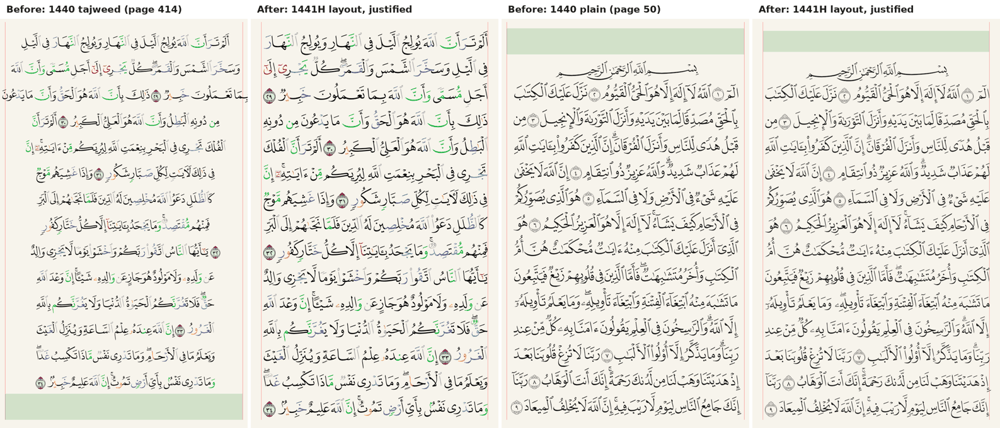

# Mushaf 1440

Mushaf 1440 (`mushafRenderer: 'qcf_v2'`, Mushaf Settings › Font) draws the
King Fahd Complex's 1441H Madinah print glyph for glyph: each word is a glyph
of its page's QCF V4 font, placed on the print's own lines.



## What the reader gets

- The 1441H print's layout: its line breaks, and its surah titles (a title
  that ended a 1421H page opens the next page here, so the page before it has
  15 lines of text).
- Full lines flush with both margins; the print's short lines (the two
  opening pages, the end of some surahs) centred.
- Tajweed colours (day and night palettes) or plain text in the reading
  theme's colour, from the same downloaded font.
- Everything the Digital Khatt pages draw over the text: bookmarks, colour
  highlights, themes, the playback band (also for reciters of other rewayat),
  the recited basmala, selection, and recitation tracking (recited ayat, the
  word being recited, mistakes in red with their underline, added-word carets,
  skipped and look-alike ayat, hidden text while memorising, the mistake
  sheet on a tap).
- Bold and medium text weight, Allah's name highlighted, two-page spreads on
  iPad, and the vertical scroll.
- Every rewayah. The printed glyphs are Hafs, so another rewayah's text is
  drawn on the same pages with the Madani 1421 font (Digital Khatt V2), with
  its own verse numbers, basmala and Show differences. Mushaf 1440 stays
  selected, and Hafs returns to its glyphs.

## Files

| File | Role |
|------|------|
| `scripts/build-qcf-1441-layout.mjs` | Builds `data/mushaf/qcf/qcf-pages.json` |
| `services/mushaf/QCFDataService.ts` | Page model: lines (title, basmala, ayah), centred flag, words |
| `services/mushaf/QCFPageLayout.ts` | Pure layout: font size, justification, baselines, hit-testing |
| `services/mushaf/QCFFontLoader.ts` | Downloads page fonts; variants `v4`, `v4-dark`, `v4-mono` |
| `services/mushaf/QCFColorPalette.ts` | In-memory font variants (palette, colour tables hidden) |
| `services/mushaf/qcfDkWordMap.ts` | Maps the shared Digital Khatt overlays onto Mushaf 1440 words |
| `components/mushaf/qcf/QCFPage.tsx` | The page: glyph runs, highlights, gestures |
| `components/mushaf/qcf/qcfDrawing.ts` | Pure drawing data: glyph runs, highlight shapes |
| `components/mushaf/qcf/useDrawsQCF.ts` | Whether pages draw Mushaf 1440 (renderer chosen and Hafs served) |

`components/mushaf/main.tsx` (pages and spreads) and
`components/mushaf/skia/ContinuousMushafView.tsx` (vertical scroll) render a
`QCFPage` instead of a Digital Khatt page when `useDrawsQCF()` is true.

## Data

`qcf-pages.json` (format 2) holds, per page, its lines in order: `k` is `s`
(surah title), `b` (basmala) or `a` (ayah); `s` the surah a title or basmala
opens; `c: 1` a centred line; `w` the words as `[id, "surah:ayah:word",
glyph code]`. A word's id is the Digital Khatt word slot id of the same word.

The build script reads the glyph codes from `data/mushaf/qcf/qpc-quran-script.db`
and the line breaks from the Quran Foundation API (mushaf 19, the layout the
V4 glyphs were drawn for). The API joins بَعْدَ مَا into one word in 2:181,
8:6 and 13:37, so words are matched by glyph code, not by location. Centred
lines come from the 1421H layout DB, checked against 1441H. The script fails
on any mismatch; the result places every one of the 83,668 words once, in
order.

```bash
node scripts/build-qcf-1441-layout.mjs --cache-dir /tmp/qcf-1441-api
```

Page fonts are not bundled: `QCFFontLoader` downloads
`https://static-cdn.tarteel.ai/qul/fonts/quran_fonts/v4-tajweed/ttf/p{page}.ttf`
on first use into `documentDirectory/qcf-fonts/p{page}-v4.ttf`. One file
serves all three variants. The 1421H glyph fonts (`QCF2xxx.ttf`) that earlier
releases downloaded are deleted.

## Layout

The page fonts carry the print's justification in the glyphs themselves:
every full line of a page has nearly the same natural width (16.09 em median,
within about 1% on a page). So:

1. The line width is Digital Khatt's (content width less `MARGIN` on each
   side), so switching fonts keeps the text block in place.
2. A page is drawn at the size that makes its widest ordinary full line (the
   widest within 1.5% of the page's median) exactly the line width.
3. Each full line spreads its spare width over its word gaps. A wider line is
   squeezed by at most 2% of the line width, then its glyphs shrink just
   enough (10 lines of 8,790).
4. Short lines keep their natural spacing and are centred.
5. A line's baseline centres the typical ink of a line (0.45 em below to
   1.19 em above the baseline) in its slot of the 15-line grid.

Glyphs are drawn with `<Glyphs>` at these positions; no paragraph shaping is
involved (the fonts map each code point to one glyph and have no meaningful
substitutions or kerning). A word's extra glyphs are zero-width marks drawn at
its base glyph, as SkParagraph's right-to-left shaping places them.

## Overlays

The shared overlay code works in Digital Khatt line indices and character
offsets. `buildQCFDkPageMap` relates the two layouts of a page by word id:

- a Digital Khatt run maps to the whole words it touches, per 1441H line;
  the two halves of a verse band that a 1421H line break split are joined;
- per-character colours map to per-word colours (a word is one glyph);
- a touch maps to the first character of the word's slot, so the verse-unit
  selection and the mistake sheet use the same code as Digital Khatt.

A word drawn in its own colour (a mistake, Allah's name) uses the `v4-mono`
typeface, also under tajweed. A hidden word is not drawn; ayah markers stay.

## Rewayat

Mushaf 1440 no longer pins Hafs. `isRendererCompatibleWithRewayah` is false
for IndoPak only, the data service never switches on its own, and the picker
and Show differences work under every font. `useDrawsQCF()` follows the text
the data service serves, so a page never draws Mushaf 1440 glyphs over
another rewayah's overlays. The list views draw a non-Hafs rewayah from its
Digital Khatt words.

## Tests

- `QCFDataService.test.ts`: every word once, 15 lines a page, titles and basmalas, centred lines.
- `QCFPageLayout.test.ts`: justification, centring, squeeze, hit-testing; all 604 pages with the real fonts' advances.
- `qcfDkWordMap.test.ts`: both layouts map word for word on all 604 pages (bundled DBs).
- `qcfDrawing.test.ts`, `QCFPage.test.tsx`: glyph runs, highlights, recitation marks, hidden text, the mistake sheet.
- `QCFFontLoader.test.ts`, `QCFColorPalette.test.ts`: downloads, variants, a real font's tables.
- `mushaf1440Rewayat.test.ts`: rewayat under Mushaf 1440 with the real store, data service and selection flow.
