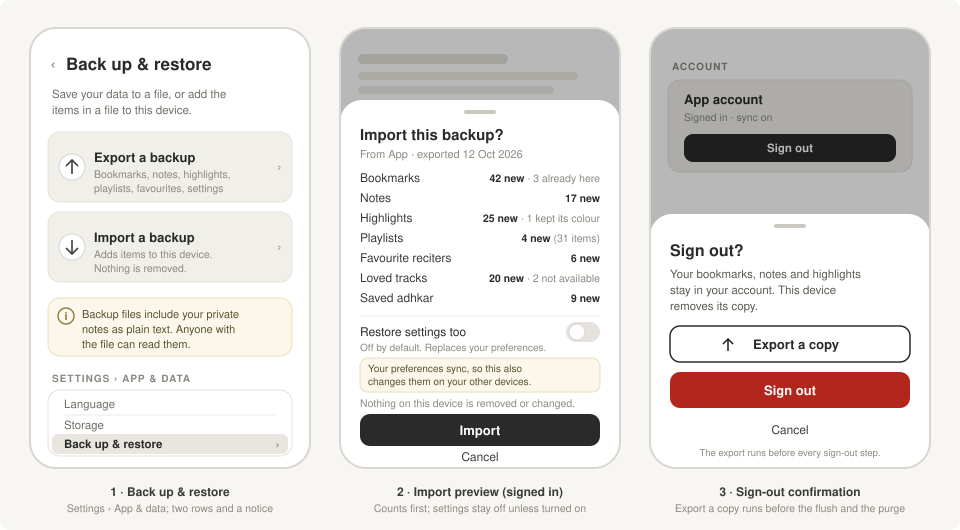

# RFC-022: Local backup: export and import of user data as a file

| Field      | Value                                                                                                                                                 |
| ---------- | ----------------------------------------------------------------------------------------------------------------------------------------------------- |
| Status     | Proposed (design only; a code PR follows acceptance)                                                                                                  |
| Date       | 2026-10-12; revised 2026-10-16 after review                                                                                                           |
| Author     | Omar Zarka                                                                                                                                            |
| Depends on | `feature/qf-integration`: #320 (sign-in and sync), #342 (sign-out purge), #346 (highlights sync), #354 (sign-out order), #357 (translation id remap) |

## Summary

Add a user-facing backup. **Export** writes the user's own data (bookmarks, notes, highlights, playlists, favourite reciters, loved tracks, saved adhkar and preferences) to one versioned JSON file and hands it to the share sheet. **Import** reads such a file, validates it strictly, shows a preview with counts, and then **merges** it into the device: union, never delete, never overwrite. Preferences are the one exception: they are replaced, and only when the user turns on **Restore settings too**, which is off by default. The file is account-neutral: it carries no `owner_scope`, `remote_id`, server timestamps, session or device ids. Imported bookmarks, notes and highlights land as guest rows, so when an account is signed in the existing `GuestDataMergeSheet` decides whether they go to the account; import itself adds no sync code. Export is also offered on the sign-out confirmation, before any sign-out step runs; the sign-out steps keep their order. Nothing changes for a user who never opens the feature, and no fork seam is needed beyond existing branding.



## Motivation

Everything a user creates lives only on the device. A lost or replaced phone, an uninstall, or "Clear data" loses it, and a user without an account has no way to move to a new phone.

The QF integration (#320) syncs bookmarks, notes, reading position, highlights (#346) and preferences, but only for users who sign in, and not playlists, loved tracks, favourite reciters or saved adhkar. Since #342, sign-out deletes the account's rows from the device (`components/auth/QfAccountCard.tsx:89` calls `purgeAccountData` at `services/sync/qfSyncDatabaseService.ts:1585`), as Quran.com web does. That is correct for a shared device, but a user who signs out has no way to keep a local copy, and edits still queued after the five-second flush are dropped once the user confirms the "Unsynced changes" alert (`QfAccountCard.tsx:22`).

The user data on `develop` today, and what this RFC puts in the file:

| Data | Where | In the file |
| --- | --- | --- |
| Bookmarks, notes, highlights | `verse-annotations.db`: `bookmarks`, `notes`, `highlights` (`services/database/VerseAnnotationDatabaseService.ts:298`, `:313`, `:333`) | Yes |
| Playlists and their items | `playlists.db`: `user_playlists`, `playlist_items` (`services/database/DatabaseService.ts:88`, `:100`) | Yes |
| Favourite reciters | `player-favorite-reciters-storage` (`services/player/store/favoriteRecitersStore.ts:94`) | Yes (ids only) |
| Loved tracks | `loved-tracks-store` (`services/player/store/lovedStore.ts:191`) | Yes |
| Saved adhkar | `adhkar.db`: `dhikr_favorites` (`services/database/AdhkarDatabaseService.ts:162`) | Yes |
| Preferences | theme, Mushaf, audio, adhkar and browse settings in eight persisted stores, which `captureSettingsDocuments()` already collects (`services/settings/qfSettingsSnapshot.ts:88`) | Yes |
| Recently played, recent Mushaf pages, play counts | `services/player/store/recentlyPlayedStore.ts:306`, `recentPages` in `store/mushafSettingsStore.ts:153`, `store/playCountStore.ts:54` | No: out of v1 (section 7) |
| Downloads and uploaded recordings | `downloads-store` (`services/player/store/downloadStore.ts:162`), `uploads.db`, and the audio files | No: files and device paths |
| Content caches | `translations.db`, `tafaseer.db`, the timestamp cache, Mushaf layout MMKV | No: downloadable again |
| Session and sync state | the secure-store session (`services/auth/bayaanSessionStorage.ts`), `qf_sync_*`, `qf_guest_imports`, `qf_reading_locations`, `qf_note_conflicts`, `qf_highlight_sync` | No: bound to an account |
| Analytics | device id (`services/analytics/deviceId.ts:4`), aggregation MMKV, `analytics-consent-store` (`store/analyticsConsentStore.ts:25`) | No: bound to the device; consent is a choice made on each device |
| Device and session state | player queue and position (`player-store`), `mushaf-session` MMKV, tasbeeh counts (`dhikr_counts`, reset daily), search history, dev settings | No |

Line numbers are from `develop`, except in `components/auth/`, `services/auth/`, `services/settings/`, `services/sync/`, `services/verse-annotations/` and `services/database/migrations/`, and in `VerseAnnotationDatabaseService.ts` in section 4: those are from `feature/qf-integration`. Lines marked "on #354" or "on #357" are from the head of that PR: #354 adds the reading activity flush to sign-out, and #357 (on top of #355) adds the legacy translation id remap.

`expo-sharing`, `expo-document-picker` and `expo-file-system` are already dependencies (used at `components/sheets/verse-actions/ShareContent.tsx:202`, `utils/importAudio.ts:27` and across `services/`). `zod` is not a declared dependency; it is only in the lockfile through build tooling.

## Decision

### 1. File format

```ts
// services/backup/backupFormat.ts
export const BACKUP_FORMAT = 'quran-user-backup';
export const BACKUP_SCHEMA_VERSION = 1;

export interface BackupFileV1 {
  format: typeof BACKUP_FORMAT;
  schemaVersion: 1;
  exportedAt: string; // ISO-8601, UTC
  appName: string; // branding.appName; informational only
  appVersion: string; // informational only
  data: {
    bookmarks: {verseKey: string; rewayahId: string; createdAt: number}[];
    notes: {
      verseKey: string;
      verseKeys?: string[];
      rewayahId: string;
      content: string;
      createdAt: number;
      updatedAt: number;
    }[];
    highlights: {
      verseKey: string;
      rewayahId: string;
      color: HighlightColor;
      createdAt: number;
    }[];
    playlists: {
      name: string;
      description?: string;
      color: string;
      createdAt: number;
      updatedAt: number;
      items: {
        reciterId: string;
        surahId: string;
        rewayatId?: string;
        addedAt: number;
      }[];
    }[];
    favoriteReciters: {reciterId: string; favoritedAt: number}[];
    lovedTracks: {
      reciterId: string;
      surahId: string;
      rewayatId: string;
      lovedAt: number;
    }[];
    savedAdhkar: {dhikrId: string; savedAt: number}[];
    settings: Partial<SettingsDocuments>; // the documents of captureSettingsDocuments()
  };
}
```

- **Account-neutral.** No row ids, no `owner_scope`, and none of the sync columns (`NEW_SYNC_COLUMNS` in `userSyncV1.ts:44`: `owner_scope`, `remote_id`, `server_created_at`, `server_updated_at`). No account id, email, session or device id. Playlist items nest under their playlist; every other row is identified by its natural key (section 4).
- **Derived values stay out.** Surah and ayah numbers come from `verseKey` on import. A verse key is `surah:ayah`, or `surah:ayah:word` for the split-verse anchor that `services/sync/qfHighlightMerge.ts` documents. The order of a playlist's items is the array order.
- **Uploads stay out.** A playlist item or loved track that points to an uploaded recording (`user_recitation_id`, `userRecitationId`) is left out, because the audio is not in the file.
- **History stays out.** Recently played, recent Mushaf pages and play counts are not in v1 (section 7).
- **Versioned.** `format` must equal `BACKUP_FORMAT`. Any change to the shape, additive or not, bumps `schemaVersion`. The app reads every older version through a chain of pure upgrade functions and rejects a newer one.
- **File name:** `${branding.appSlug}-backup-YYYY-MM-DD.json` (`config/branding.js:14`), written with two-space indentation so a user can read it.

### 2. Export

- **Where:** a new **Back up & restore** row in the App & data section of Settings (`app/(tabs)/(d.settings)/index.tsx:94`) opens a new screen, `app/(tabs)/(d.settings)/backup.tsx`, with **Export a backup** and **Import a backup**. Strings go in `i18n/locales/*/settings.json`.
- **What:** the rows the user sees now. Signed out, that is the `'guest'` scope; signed in, it is the account scope (`ownerScope()` in `services/verse-annotations/VerseAnnotationService.ts:19`). Guest rows that the user kept separate are not exported while an account is signed in; they are exported after sign-out, when they are the rows the user sees (section 7). Annotations are read in one read transaction. Playlists, saved adhkar and store state are read as they are, and preferences come from `captureSettingsDocuments()`.
- **How:** write the file to the cache directory, open `Sharing.shareAsync(uri, {mimeType: 'application/json', UTI: 'public.json'})`, then delete the cache file. From the share sheet a user can save to Files, iCloud Drive or Google Drive, or send the file to themselves. No network; it works signed in or signed out.
- **Privacy notice**, above the button: "This file includes your private notes as plain text. Anyone who has the file can read them." There is no encryption in v1.

### 3. Sign-out: "Export a copy" before every sign-out step

A confirmation sheet opens before `signOut` (`QfAccountCard.tsx:55`) runs, because sign-out now deletes data from the device:

- Title "Sign out?". Text: "Your bookmarks, notes and highlights stay in your account. This device removes its copy."
- Buttons: **Export a copy**, **Sign out** (destructive), **Cancel**.
- **Export a copy** runs the export of section 2 for the account scope and returns to the sheet when the share sheet closes. It calls no sign-out step, and it never signs out on its own.
- **Sign out** closes the sheet and calls `signOut` as it is. With #354, `signOut` (`QfAccountCard.tsx:56` on #354) runs these steps in this order:
  1. `qfSyncLifecycle.requestSync()`, then `qfSyncLifecycle.waitForIdle()` together with `qfActivityDayTracker.flush()` (`services/sync/qfActivityDayTracker.ts:228` on #354), for at most `SIGN_OUT_FLUSH_MS` (five seconds). The tracker flush sends queued reading activity to QF while the session can still credit it.
  2. The "Unsynced changes" alert, when the outbox still has entries.
  3. Stop `qfSyncLifecycle` and `qfSettingsSyncLifecycle`, then `bayaanAuthService.logout()`.
  4. `qfActivityDayTracker.clearAccount(accountId)` (`qfActivityDayTracker.ts:296` on #354), then `qfSyncDatabaseService.purgeAccountData(accountId)`.

This RFC does not reorder, skip or add a step in that list. The export runs before step 1 and is complete before `signOut` starts: the sheet does not accept **Sign out** while an export is still writing its file, so the export always reads the rows before the purge deletes them. The export reads the local rows, so it also holds the edits that the flush could not deliver. The "Unsynced changes" alert stays as it is; a user who cancels it can open the sheet again and tap **Export a copy**.

### 4. Import

1. **Pick:** `DocumentPicker.getDocumentAsync({type: ['application/json', 'text/plain', 'application/octet-stream'], copyToCacheDirectory: true})`, as in `utils/importAudio.ts:27`. Some Android file managers report JSON as plain text or bytes, so the content decides, not the type.
2. **Size:** reject a file over 20 MB before reading it.
3. **Validate:** `JSON.parse`, then `parseBackup(value)`, a pure, hand-written validator in the style of `services/car/parse.ts` and the sanitizers in `qfSettingsSnapshot.ts`. It is strict. Any of these rejects the whole file with one message, and nothing is written: an unknown `format`, a newer `schemaVersion`, an unknown key, a wrong type, a malformed verse key, a surah outside 1–114, a colour that is not a `HighlightColor`, or a note longer than `MAX_SYNC_NOTE_BODY_LENGTH` (200,000 characters, `services/sync/bayaanSyncCodec.ts:4`, so every imported note can sync). For `settings`, it checks only that each key is a known document name and that each value is an object. It does not judge or rewrite the values in a document: `applySettingsDocuments` sanitizes them (step 8), so a legacy translation id reaches its remap.
4. **Plan:** `planImport(backup, current)`, a pure function, counts for each type the rows to add, the rows already present, and the rows this app cannot use (a reciter id that this catalog does not have, a dhikr id that is not in `adhkar.db`).
5. **Preview:** a sheet shows those counts, the source app name and export date, and a **Restore settings too** switch. The switch is **off by default**, for two reasons: preferences are replaced, not merged, and they sync to the account, so while an account is signed in a restore changes the preferences on every device of that account. When an account is signed in, the text under the switch says so: "Your preferences sync, so this also changes them on your other devices." The sheet also says: "Bookmarks, notes and highlights are added to this device first. The app then asks whether to add them to your account." Nothing is written before **Import**.
6. **Merge:** one transaction for each database. No existing row is updated or deleted. Importing the same file twice changes nothing the second time.

| Type | Natural key | When the device already has the key |
| --- | --- | --- |
| Bookmark | verse key (unique per scope: `idx_bookmarks_owner_verse_key`, `userSyncV1.ts:425`) | skip |
| Highlight | verse key (one per verse: `idx_highlights_owner_verse_key`, `userSyncV1.ts:435`) | same colour: skip; other colour: keep the current colour and count it |
| Note | verse key + exact content | skip |
| Playlist | name, trimmed | add the missing items to that playlist, at the end |
| Playlist item | reciter id + surah id + rewayat id, in its playlist | skip |
| Favourite reciter | reciter id | skip |
| Loved track | reciter id + surah id + rewayat id | skip |
| Saved dhikr | dhikr id | skip |
| Settings | (none) | replaced through `applySettingsDocuments()` (step 8), only when the switch is on |

7. **Guest rows only.** Annotations go through one new method, `VerseAnnotationDatabaseService.importGuestAnnotations(rows)`, which hard-codes `GUEST_OWNER_SCOPE` (`userSyncV1.ts:4`), uses `INSERT OR IGNORE`, keeps the file's `created_at` and `updated_at`, and writes no outbox entry. It does not reuse the `*ForOwnerScope` helpers: they stamp `Date.now()` (`VerseAnnotationDatabaseService.ts:210`), and `upsertHighlightForOwnerScope` overwrites the colour on conflict (`:527`).
8. **Settings only through `applySettingsDocuments`.** When the switch is on, the import passes `data.settings` to `applySettingsDocuments()` (`qfSettingsSnapshot.ts:353`), the same path that applies the account's settings, and writes no settings store itself. With #357, that path sanitizes the Mushaf document with `sanitizeRemoteDocument` (`qfSettingsSnapshot.ts:260` on #357), which maps `selectedTranslationId` through `remapLegacyTranslationId` (`services/translation/translationRemap.ts:25` on #357). So a backup made before the switch to QF translations cannot leave the user on a translation id that no longer exists.
9. **After the merge:** reload the annotation views. Signed out, or with `qfSyncEnabled` off, the new rows show at once. Signed in, the app requests a normal sync run, the same request a local edit makes (`VerseAnnotationService.ts:23`). That run's `getOffer` (`services/sync/qfSyncLifecycle.ts:442`) counts the guest rows that the per-row ledger has not seen (`services/sync/qfGuestImportService.ts:234`) and opens `GuestDataMergeSheet`. **Merge** copies them into the account, and they sync; **Keep separate** keeps them on the device, and they show again after sign-out. Bookmarks, notes and highlights from the file reach the server only when the user taps **Merge**. Restored preferences are different: a restored preference is a local edit, the same as a change in Settings. The settings sync picks it up through its store subscription (`services/settings/qfSettingsSyncCoordinator.ts:376`) and sends it to the account, so it reaches every device of the account. That is why the switch is off by default (step 5).

### 5. Code layout

- New: `services/backup/backupFormat.ts`, `parseBackup.ts`, `exportBackup.ts`, `importBackup.ts` (`planImport` and `applyImport`), `services/backup/__fixtures__/v1.json`, `services/backup/__fixtures__/v1-legacy-translation.json`, `components/backup/ImportPreviewSheet.tsx`, `app/(tabs)/(d.settings)/backup.tsx`.
- Changed: the Settings item list and `_layout.tsx` (one row, one `Stack.Screen`), `components/auth/QfAccountCard.tsx` (the sign-out sheet in front of `signOut`; `signOut` itself does not change), `components/auth/__tests__/QfAccountCard.test.tsx` (the order test), `VerseAnnotationDatabaseService.ts` (`importGuestAnnotations`), the settings locale files.
- No new dependency and no schema migration. The code PR targets `feature/qf-integration`, because it needs the owner-scope columns and the merge sheet. It lands after #354 and #357 (with #355, its base) reach that branch: the sign-out sheet and its test build on #354's order, and the legacy translation id test needs #357's remap.

### 6. Forks

No new seam. The file name uses `branding.appSlug`, and the `appName` field uses `branding.appName` (RFC-007). The `format` id is the same for every app built from this code, so a file can move between such apps; reciter ids that one catalog lacks show as "not available here" in the preview. A fork with its own translation provider keeps its translation ids on restore, because `remapLegacyTranslationId` only maps the retired bundled `saheeh` when the content engine does not manage translations.

### 7. Resolved in review

The first draft left three questions open. The review answered them, and this RFC now follows those answers:

1. **"Restore settings too" is off by default.** Preferences sync to the account, so a restore while signed in changes every device of the account (section 4, step 5).
2. **Play and reading history are out of v1.** Recently played, recent Mushaf pages and play counts change all the time and mean little on another device (section 1).
3. **While signed in, export only the rows the user sees.** Guest rows that the user kept separate stay out of a signed-in export (section 2).

## Alternatives considered

- **Copy the SQLite files.** Rejected. The files carry `owner_scope`, `remote_id`, the outbox and the guest-import ledger, so restoring them on another device or account corrupts sync state. They are tied to the schema version (`userSyncV1` to `V5`), they can only replace, never merge, and the AsyncStorage and MMKV stores are not files that the app can copy safely. OS-level app backup restores the databases as a whole, with the same problems.
- **Cloud backup (iCloud Drive, Google Drive).** Rejected for v1. It needs native work and entitlements for each platform, and a sign-in to a second provider. The share sheet already lets a user save the file to either service.
- **Passphrase encryption.** Rejected for v1. A forgotten passphrase loses the data with no recovery, and it adds a crypto dependency. The user chooses where the file goes, and the UI says that notes are plain text. A later `schemaVersion` can add an encrypted envelope.
- **One CSV per entity.** Rejected. It needs several files or a zip, it cannot nest playlist items, it has no place for a version, notes with commas and newlines need escaping, and preferences do not fit a table.
- **Import that overwrites.** Rejected. It deletes everything created since the backup, a wrong file empties the library, and with sync on the deletes would reach the account. A merge is safe and idempotent.
- **Import straight into the signed-in account.** Rejected. It needs a second consent flow and new upload code. Guest rows plus the existing merge sheet already give consent and upload.
- **Write restored settings to the stores directly.** Rejected. It skips the sanitizers and the legacy translation id remap in `applySettingsDocuments`, so an old backup could select a translation that no longer exists.
- **Export from inside `signOut`, or from the "Unsynced changes" alert.** Rejected. Both put the export between sign-out steps. Before every step, on the sheet, the export changes nothing in the order that #354 tests.
- **`zod` for the schema.** Rejected. It is not a declared dependency, the format is small, and hand-written guards match the rest of the code base.

## Consequences

- **Positive:** users can keep and move their data without an account; sign-out no longer has to mean loss; no server work, no new dependency, no migration.
- **Neutral:** sync is unchanged; the sign-out steps and their order are unchanged; imported annotations use the existing guest-merge consent; restored settings use the existing `applySettingsDocuments` path; no new fork seam.
- **Negative / risks:** the file holds private notes in plain text, and the user decides where it goes. The strict schema means an older app rejects a newer file. **Restore settings too** replaces preferences (opt-in, off by default), and while signed in the change reaches every device of the account; the preview says so. A highlight in a different colour from the device's is not imported. Sign-out gets one more step.

## How we'll know it worked

- **Round trip:** seed every included type, export, wipe, import: the data is equal, ignoring local ids. The test runs signed out and signed in.
- **Idempotent:** importing the same file twice gives the same result as importing it once.
- **Golden fixture for each `schemaVersion`:** `services/backup/__fixtures__/v1.json` (and each later version) parses and imports with the current code. A change to the format without a new version and fixture fails the test.
- **Legacy translation id:** `services/backup/__fixtures__/v1-legacy-translation.json` is a backup whose Mushaf settings carry a legacy `selectedTranslationId` (an AlQuranCloud id such as `en.pickthall`; a second case uses the retired `saheeh`). Imported with **Restore settings too** on, the store never holds the legacy id. It holds the id that `remapLegacyTranslationId` returns when that edition is bundled or on the device (for example, `en.pickthall` becomes `19` when the content engine manages translations, and `saheeh` becomes the bundled `clear-quran` when it does not). Otherwise it keeps the current selection, as `applySettingsDocuments` does for the account's settings.
- **Settings off by default:** the preview opens with **Restore settings too** off; an import with the switch off leaves `captureSettingsDocuments()` unchanged. Signed in, the preview shows the text about other devices.
- **Guest only:** with an account scope active, an import writes rows only with `owner_scope = 'guest'`, adds no `qf_sync_outbox` row, and makes no network request.
- **Signed-in export:** with guest rows kept separate and an account signed in, the export holds only the account's rows.
- **Account-neutral:** a deep key scan of an export finds no `owner_scope`, `remote_id`, `server_*` key, account id or email.
- **Sign-out order:** #354's order test in `components/auth/__tests__/QfAccountCard.test.tsx` still passes as it is: **Sign out** alone records `flush`, `activity:flush`, `stop`, `logout`, `activity:clear:<id>`, `purge:<id>`. A new case taps **Export a copy** and then **Sign out**: it records `export` first and then the same six events in the same order, and the export's file write resolves before `requestSync` is called.
- **Rejects:** a wrong `format`, a newer `schemaVersion`, a file over 20 MB, an unknown key or a bad verse key is rejected, and nothing is written.

## Open questions

None. The review resolved the three questions of the first draft (section 7).
