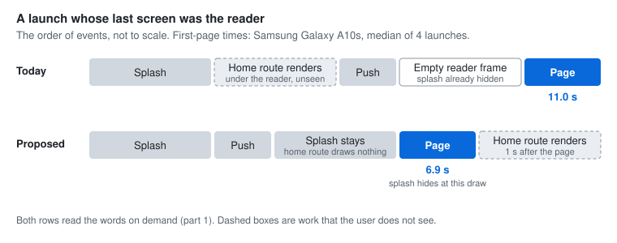

# RFC-023: A cheaper Mushaf start-up for every phone

| Field  | Value               |
| ------ | ------------------- |
| Status | Proposed            |
| Date   | 2026-10-30          |
| Author | Omar Zarka (Qariah) |

## Summary

At every launch, `DigitalKhattDataService` reads all 83,668 words of the active rewayah and builds them into maps, and the boot waits for that before the splash hides. On a 2 GB Android phone this is the largest single cost of a launch. This RFC proposes four changes. Together they make the Mushaf load and the first reader page cheaper on every phone. They add no setting, change no public method of the service, and change no bundled database file:

1. **Words on demand.** The load reads a verse index, not every word. A getter reads the words that it needs.
2. **A query cache.** The two queries that remain are cached under the content-addressed name of the database copy.
3. **Line fits across launches.** The fit of each justified line is kept for the next launch of the same app build.
4. **The restore-launch order.** When the app reopens the reader, the reader's first page goes first, and the splash hides when that page draws.

Each part comes as its own small code PR after this RFC, with tests.

## Motivation

The numbers below come from a Samsung Galaxy A10s (Android 10, 2 GB RAM, 32-bit `armeabi-v7a`), release builds of a fork that runs this code (Expo SDK 57, React Native 0.86). `develop` is now on SDK 58 and React Native 0.88. The Mushaf data files named below did not change between the two. `app/_layout.tsx` and `components/mushaf/main.tsx` did change; the line numbers are for `develop`.

### 1. The load builds every word

`loadMainSnapshot` (`services/mushaf/DigitalKhattDataService.ts:1194`) calls `readWordRows` (`:615`), which runs `SELECT id, text, location FROM words`, and then `buildWordsData` (`:517`). That builds 83,668 rows into `wordsById`, `wordInfoById` and `verseWords`. On the A10s:

- The words are ready about 12 s after the load starts.
- The SQLite read runs on a native IO thread for about 1.8 s.
- Then the JS thread runs for about 6.7 s in one piece: it converts the 83,668 rows to JS objects and builds the maps. No other JS work runs in that time.

The boot waits for this load. `services/AppInitializer.ts:285` registers "Mushaf Preload" as non-critical, but `initialize()` awaits the non-critical services too (`Promise.allSettled`, `:127`). `services/appBoot.ts:67-69` awaits `appInitializer.initialize()` ("This blocks splash screen"). On the A10s, a build that moved only this load off the splash path cut the cold start from 16.9 s to 10.7 s. A user who only listens pays this cost at every launch.

`MushafPreloadService.ts:169-174` also loads the Skia fonts after the data, but the fonts need none of the data.

### 2. Two small queries are slow during a launch

With part 1, the load runs two queries: the verse index (one `GROUP BY`) and the page lines (`readLayoutRows`, `DigitalKhattDataService.ts:649`). On a desktop they take 17 ms and 5 ms. On the A10s, during a launch, they took 2.3 s together, because each `await` resumes only after the other JS work of the launch. Their results change only when a bundled database changes, and each database copy already has a content-addressed name (`contentAddressedDbName`, `:194`).

### 3. The first page builds each justified line twice

`components/mushaf/skia/SkiaLine.tsx:241-274` builds a justified line, measures it, and builds it again with the fit (the word size and the extra space width). `components/mushaf/skia/justifiedSpace.ts:114-132` keeps the fit for the session only. So the first page after each launch builds every justified line twice. On the A10s that is about half of the 0.7 s of paragraph work on the first page.

### 4. A restore launch draws the home route first

When the last screen was the reader, `app/_layout.tsx:398-429` pushes `/mushaf` over the home route. The home route (`app/(tabs)/(a.home)/index.tsx`, `RecitersView`) renders and mounts first, under the reader, where nobody sees it. On the A10s that held the push for 0.7–1.2 s, and its later work competed with the reader's first page.

After the push, the splash hides through `runAfterInteractions` (`:422`) and the effect at `:431-450`, not when the page draws. The reader page has opacity 0 until its `onReady` (`components/mushaf/main.tsx:252`, `:298`, `:307`). So the user can see an empty reader frame before the page.

## Decision

### Part 1: words on demand (`services/mushaf/DigitalKhattDataService.ts`)

- The load opens the words database and runs integrity counts:

  ```sql
  SELECT COUNT(*) AS n, COUNT(id) AS ids, COUNT(text) AS texts, COUNT(location) AS locations FROM words;
  ```

- Then it reads a verse index with one native query. That is 6,236 rows, the first and the last word id of each verse:

  ```sql
  SELECT surah, ayah, MIN(id) AS first, MAX(id) AS last FROM words GROUP BY surah, ayah ORDER BY first;
  ```

- The connection stays open. A `WordStore` for each words database answers the getters. A getter reads the 2,048 ids around a word with `getAllSync` (`WHERE id BETWEEN ? AND ?`). So every getter stays synchronous, and no caller changes.
- The store keeps the 24 chunks and the 1,024 verses that were used last.
- The surah start pages and the verse-to-page map come from the verse index and the layout.
- A copy that fails the counts or the index checks throws inside the read. The existing delete, re-import and retry path then handles it, as it does for the full read today.
- `MushafPreloadService` loads the Skia fonts while the data loads.

The design uses three facts of the bundled data. All 8 words databases have them: the ids run from 1 to 83,668 with no gaps, each verse is one id range, and no field is NULL. A test checks them.

The Hafs words database stores its rows in a shuffled order (the rowid is not the id), so a chunk read there scans the table. That takes 1.6 ms on a Mac and about 40 ms on the A10s (an estimate), once for each 2,048 words. An index on `id` would remove the scan, but it changes the bundled files, so this RFC does not propose it.

**Result (A10s):** the words are ready 2.0–2.4 s after the load starts, not about 12 s. The fonts load in 0.35–0.44 s at the same time. Memory on the home route: 230 MB → 216 MB (PSS).

### Part 2: a query cache

- A load stores the verse index and the page lines in MMKV after it reads them from a copy whose md5 matched its asset (the existing `verifyCopy` check, `DigitalKhattDataService.ts:1454`). The rows are packed in an `Int32Array` and stored with `set(key, ArrayBuffer)`.
- The key is `<format>:<kind>:<base name>:<content-addressed copy name>`. A new bundled database has a new copy name, so it never reads an old entry. A write removes the older entries of the same kind and base name.
- The next load takes the rows from MMKV. The page lines then need no database work. The verse index waits only for the md5 check of the words copy.
- A damaged entry falls back to the query. `resetDatabases()` clears the cache.
- Size: about 100 KB for each words database in use, and 250 KB for the page lines.

**Result (A10s):** after the first launch, a launch no longer spends the 2.3 s of the two queries.

### Part 3: line fits across launches (`components/mushaf/skia/justifiedSpace.ts`)

- `getLineFit` looks in a persistent store when the session map has no fit. `setLineFit` writes to both. Two lines change in `justifiedSpace.ts`.
- The store is a separate MMKV instance. The key is a hash of the existing fit key (the line text, its justification, the font, the size and the width). The value is `wordSize,spaceExtra`.
- Each new app build starts with an empty store (`expoConfig.extra.version`: `semanticVersion` and `buildNumber`). So a new font or new shaping code never uses an old fit. With no build version (for example in tests), there is no store.
- A value that is not a finite, positive fit is never stored and never served.

**Result:** the first page after a launch builds each justified line once.

### Part 4: the restore-launch order

- A small module, `services/mushaf/readerRestoreGate.ts`, reads `mushafSessionStore.getLastScreenWasMushaf()` once and keeps the value for the launch.
- While a restore is pending, the home route returns an empty `View`, not `RecitersView`.
- The wait ends at the first of these events:
  - 1 s after the reader's first page draws. The reader calls `noteReaderPageDrawn()` from its page `onReady`, and at mount in the vertical mode.
  - A return to the home route (a focus after a blur).
  - A launch that does not push the reader: no restore, a deep link, or a share intent.
  - 15 s after the first read (a safety limit).
- After the push, the root layout hides the splash when the reader's first page draws (`whenReaderPageDrawn()`). It does not wait for `runAfterInteractions`. A deadline of 4 s from the start of the restore effect still hides the splash for a reader that never draws.
- `develop` already starts the Mushaf load in the boot. With parts 1 and 2, the data and the fonts are ready before the push.



**Result (A10s, a launch that restores the reader, median of 4 launches, the time to the first page):**

| Step (each row adds to the row above)                     | First page |
| --------------------------------------------------------- | ---------- |
| Part 1 only, Mushaf load after the splash                 | 11.00 s    |
| + part 2 (this build also moved a fork-only storage read) | 9.52 s     |
| + the Mushaf load in the boot, as `develop` does today    | 9.06 s     |
| + part 3, and the empty home route of part 4              | 7.44 s     |
| + the splash hide at the page draw (part 4)               | **6.90 s** |

### What does not change

- No public method of `DigitalKhattDataService` changes its signature.
- No new setting or feature flag. Every phone gets all four parts.
- No bundled database file changes.

### Delivery

Four code PRs, in this order, each with its tests:

1. **Part 1.** An `*.alldbs` test compares every getter with the old full build on all 8 words databases: each word's text and info, each verse's words and text, each verse's page, the surah start pages, page-to-surah, the text of every ayah line, and a side rewayah. The existing service tests pass with no change; the SQLite fakes answer the new queries and `getAllSync`.
2. **Part 2.** A hit, a miss, a damaged entry, an untrusted copy (no write), a new copy name (a miss), and a reset (the cache is empty).
3. **Part 3.** The same build keeps a fit; another build starts empty; no build version means no store; a bad value is never stored.
4. **Part 4.** Each end condition of the wait, and the safety limit.

## Alternatives considered

1. **Pre-drawn page images.** Some Quran apps show page images on weak phones. Rejected: each rewayah and layout needs a large download or bundle; the images lose the tajweed colours, the highlights and the text features; and they are a second renderer to keep.
2. **Build the maps on a background thread or a JSI worker.** Rejected: the synchronous getters need the maps on the JS thread, so the 83,668 entries must still cross to it. It also adds a native dependency.
3. **Keep the full build, but read it in chunks and yield between them.** Rejected: the JS thread gets shorter blocks, but the total work (about 12 s on the A10s) and the memory stay, at every launch, also for users who only listen.
4. **Store the built maps.** Rejected: the maps are about 33 MB on the A10s, and to read them back costs most of the build.
5. **Precompute the line fits at build time.** Rejected: a fit depends on the font size and the page width of the device.
6. **Render the home route at a lower priority on a restore launch.** Rejected: its work still competes with the first page. An empty view costs almost nothing.

## Consequences

- **Positive:**
  - Every phone does less work and uses less memory at every launch. On a 2 GB phone, the Mushaf load takes about 2 s, not about 12 s. On a fast phone the gain is smaller.
  - A user who only listens pays almost nothing for the Mushaf at launch.
  - A restore launch shows the page with no empty reader frame.
- **Neutral:**
  - The public API of the data service and the bundled database files do not change.
- **Negative / risks:**
  - A wrong word on a page is a severe defect. The all-databases test compares every getter with the old build, and it must stay in CI.
  - The data facts of part 1 (no gaps in the ids, one id range for each verse) become a contract of the bundled databases. A new words database must keep them. The test finds a break.
  - The words database connection stays open while the app runs (one for each words database in use).
  - A chunk read runs on the JS thread: about 40 ms on the A10s for the Hafs database, once for each 2,048 words. A fast swipe into a new chunk can drop a frame.
  - MMKV holds about 100 KB for each rewayah in use, 250 KB of page lines, and a few hundred KB of line fits.
  - The first launch after an install or an update runs the two queries once and starts with no line fits.
  - On a restore launch the splash stays until the page draws. A user who goes back at once sees an empty home screen for about 1 s while it renders.

## How we'll know it worked

- The all-databases getter test passes in CI on all 8 words databases.
- On a 2 GB Android phone, release build:
  - the words are ready less than 3 s after the load starts;
  - the `app-initializer-ready` boot breadcrumb comes earlier by the time the load saves;
  - a launch that restores the reader shows the first page with no empty reader frame, and sooner than today.

## Open questions

1. **The cache store.** This RFC uses MMKV: it is already a dependency, and it reads synchronously. A file next to each database copy is the alternative. It would keep the cache with its copy and delete it with the copy.
2. **The 1 s delay** before the home route renders after the reader's page. A shorter delay gives a full home screen sooner after a quick back gesture. A longer delay keeps the next pages' builds free of competing work.
3. **The 15 s safety limit and the 4 s splash deadline.** Both only catch a reader that never draws. They need no change on a phone that works correctly.
