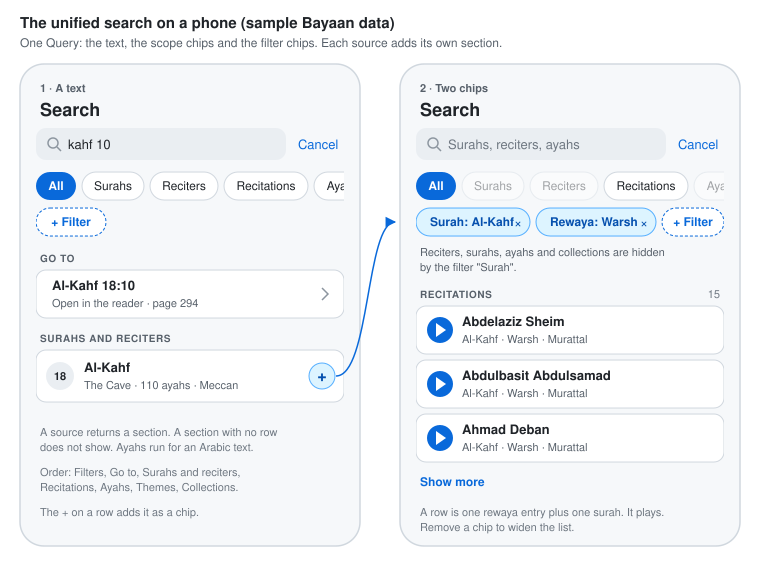

# RFC-024: Unified search: one query, sources and filters

| Field     | Value                                                                                                    |
| --------- | -------------------------------------------------------------------------------------------------------- |
| Status    | Proposed (the design is doc-only; stacked code PRs follow after the shape is agreed)                     |
| Date      | 2026-11-20                                                                                               |
| Author    | Omar Zarka (Qariah)                                                                                      |
| Builds on | RFC-012 and RFC-020 (the `branding.searchFilters` seam and the chip flow); the Quran word search of #521 |
| Replaces  | the shape of the open RFC-020 code PR #317. We then close that PR with a pointer to this RFC.            |

## Summary

Bayaan has one ranking engine for search (`utils/search/catalog.ts`), but six surfaces call it, and each surface fixes its own result types, filters, history and tap action. This RFC proposes one model for all of them: a **Query** (the text, the scope chips and the filter chips), **sources** (one module for each thing that search can find; each source returns its own section) and **filters** (one abstraction for rewaya, style, collections, flags, and a reciter or a surah as a chip). An entry point is a first Query plus its host screen. With this model the Search tab understands `2:255`, `page 50` and `juz 30`, lists recitations (one rewaya entry of one reciter, plus one surah), keeps the Ayahs section of #521 unchanged, and adds passage themes and collections. The reciter profile search and the Mushaf search use the same engine. A fork adds filters as plain data in `branding.search`. A prototype exists behind a Settings switch. With the switch off, each screen is unchanged. We can share a build or a branch.

## Motivation

### One engine, six surfaces

The ranking is shared: `createSurahSearch` and `createReciterSearch` (`utils/search/catalog.ts:73`, `:111`) on `createSearchIndex` (`utils/search/createSearchIndex.ts:361`). The surfaces are not:

| Surface | Finds | Filters |
| --- | --- | --- |
| Search tab (`components/search/SearchView.tsx`) | surahs, reciters, Ayahs (#521) | none on a phone; scope chips on iPad (`TabletSearchResults.tsx`) |
| Mushaf search (`components/mushaf/MushafSearchView.tsx`) | surahs, a verse, a page, a juz, Ayahs (#521) | none |
| Browse reciters (`components/browse/BrowseReciters.tsx`) | reciters | teacher, student, style, rewaya, has-photo |
| Browse surahs (`components/browse/BrowseSurahs.tsx`) | surahs | sort |
| Reciter profile (`components/reciter-profile/ReciterProfile.tsx:322`) | the surahs of one reciter | rewaya tab, loved only, sort |
| Organize recitation sheet (`components/sheets/OrganizeRecitationSheet.tsx:436`) | reciters | none |

### What goes wrong

1. **Only the Mushaf search reads a reference.** `parseSearchQuery` (`components/mushaf/MushafSearchView.tsx:238-389`) knows `2:255`, `page 50` and `juz 30`. The Search tab does not.
2. **Filters join across rewaya entries.** `BrowseReciters.tsx:283-341` checks the surah, the teacher, the style and the rewaya, each with its own `reciter.rewayat.some(...)`. Each check can pass on a different entry. In the bundled catalog, 7 reciters have an entry that lacks a surah that another of their entries has. Example: the Al-Duri 'an Al-Kisa'i entry of Mishary Alafasi has 6 surahs and no Al-Fatihah. Choose a reciter for Al-Fatihah, set the rewaya filter to Al-Duri, and the list still shows him. A tap then plays his Hafs entry (`pickRewayatId`, `utils/rewayatPreference.ts:33`).
3. **A lost param.** Three call sites push `reciter/browse` with `view: 'favorites'` (`components/search/SearchView.tsx:571`, `components/browse/BrowseSurahs.tsx:292`, `app/(tabs)/(b.surahs)/index.tsx:52`). Neither route reads `view` (`app/(tabs)/(a.home)/reciter/browse.tsx:22`, `app/(tabs)/(b.search)/reciter/browse.tsx:24`), so "browse favourites" for a surah lists every reciter. The two route copies also read different params.
4. **Filters live in one screen.** They are local state of `BrowseReciters` (`:169-193`) plus hidden route params. The user cannot see, combine or remove them from the Search tab. This is the problem that RFC-012 and RFC-020 describe.
5. **Two search histories:** `recentSearches` (`SearchView.tsx:82`) and `mushaf-search-history` (`MushafSearchView.tsx:168`).
6. **Each new result kind is wired once for each surface.** #521 adds its Ayahs section three times: `SearchView.tsx:303`, `TabletSearchResults.tsx`, and `MushafSearchView.tsx:746`. Translation, themes or playlists would need the same work again in each place.

## Decision



### 1. The Query

```typescript
// utils/search/unified/types.ts
export type ResultKind = 'reciter' | 'surah' | 'recitation' | 'ayah' | 'collection';

export interface SearchQuery {
  text: string;
  /** The scope chips. An empty list means each kind. */
  kinds: ResultKind[];
  /** The filter chips. OR inside one filter, AND across filters. */
  filters: Record<FilterId, string[]>;
  /** The order of a list with no text. */
  sort?: 'relevance' | 'name' | 'mushaf' | 'revelation';
}
```

- **OR inside a filter, AND across filters.** RFC-020 had one value for each filter. The browse filter sheet of today is already multi-select (`components/browse/FilterModal.tsx:38-42`), so one value would be a regression.
- **The Query is local state of the host screen.** A link sets only the first Query (`queryFromParams`): the params `q`, `kinds`, `sort` and one param for each filter id. The params of today stay readable: `surahId`, `teacher`, `student`, `hasPhoto`, and `view=favorites`, which then works. RFC-020 kept the state in the URL with `router.setParams`. That fights the native iOS search bar of the Search tab, and the Mushaf search overlay has no route of its own.
- Pure functions change a Query (`toggleKind`, `setFilter`, `addFilterValue`, `removeFilterValue`). `sanitizeQuery` removes a filter id or a value from a link that the registry does not know.

### 2. The recitation unit

A **recitation** is one rewaya entry of one reciter (`Rewayat.id`) plus one surah. It is the thing that plays.

```typescript
export interface RecitationUnit {
  id: string; // the Rewayat id
  reciter: Reciter;
  rewayat: Rewayat;
  surahIds: ReadonlySet<number>;
}
```

Each filter on the rewaya, the style, the surah, the timestamps or the download state must pass on the **same unit**. A reciter row passes when one unit of the reciter passes all the unit-side filters together. So "Al-Fatihah + Al-Duri" lists only a reciter whose Al-Duri entry has Al-Fatihah, and the row plays that entry. The bundled catalog has 224 reciters, 268 units and 25,208 recitation rows. The recitation source counts its matches without an array of each row, and it keeps only the rows that it shows.

### 3. Sources

```typescript
export interface SearchSource<Row> {
  id: string;
  kind: ResultKind;
  /** More kinds that let the source run (go-to has surah and verse rows). */
  alsoKinds?: readonly ResultKind[];
  /** A source can decline a Query. */
  runs: (q: SearchQuery, ctx: SearchContext) => boolean;
  /** While it loads, this source takes the whole list. */
  holds?: (q: SearchQuery, ctx: SearchContext) => boolean;
  /** The runner waits this long before it calls `search`. */
  debounceMs?: number;
  search: (q: SearchQuery, ctx: SearchContext, run: SearchRun) => Section<Row> | Promise<Section<Row>>;
}

export interface Section<Row> {
  status: 'done' | 'loading' | 'error';
  rows: Row[];
  total: number;
  /** A count, and a note such as "Searched in the Hafs text". */
  header?: SectionHeader;
  /** When true and the section has rows, it takes the whole list. */
  exclusive?: boolean;
}
```

A source returns a **section**, not a flat list. So the #521 search keeps its header, its notes, its paging and its own row types. The row components and the tap actions are in the UI layer, not in the source. The modules in `utils/search/unified/` are pure: no React, no store and no native module. The app wiring (`services/search/unifiedSearch.ts`) passes the data in a `SearchContext`.

| Source | Kind | Engine on `develop` | Runs when |
| --- | --- | --- | --- |
| `goto` | surah, ayah | a copy of the verse, page and juz rules of `parseSearchQuery`, rewayah-aware through `components/mushaf/mushafSearchVerses.ts:93`; three new forms: `p50`, `2 255` and `kahf 10` | the text is a reference; no wait |
| `surah` | surah | `createSurahSearch` | text that is not a reference |
| `reciter` | reciter | `createReciterSearch` | text that is not a reference |
| `recitation` | recitation | the units × their surahs | a reciter or a surah chip is on; or filters on the reciter side and on the surah side; or the scope is Recitations and the Query has text |
| `ayah-arabic` | ayah | `QuranSearchDataService.search` (`services/search/QuranSearchDataService.ts:102`); rows from `quranResultRows` (`components/search/quran/quranResultRows.ts:174`), drawn by `QuranResultRowView`, unchanged | an Arabic text (`isQuranQuery`, `:53`); 300 ms wait |
| `ayah-theme` | ayah | the 1,051 passage themes of `data/quran-themes.json` | 3 letters or more; 300 ms wait |
| `collection` | collection | the system playlists, the reciter collections and the user's playlists, by title | 2 letters or more, or the scope is Collections |

The runner (`runSearch`) is pure too. For each Query it:

- asks each source whose kind can show and whose `runs` gives true;
- shows a sync section at once and a `loading` section for an async source, so a slow source does not block a fast one;
- waits `debounceMs` before it asks an ayah source (300 ms, the wait of the Search tab today), and asks nothing when a new Query aborts the wait;
- turns a throw into an `error` section of that source only;
- gives the whole list to an exclusive section with rows, or to a holding source while it loads. So for `ر ح م` the catalog rows do not show and then go away (the rule of `showsOwnRows`, `quranResultRows.ts:232`);
- aborts the run of the previous Query (`AbortSignal`), so a stale answer never draws.

The sections show in this order: Filters (suggestions, below), Go to, Surahs and reciters (one relevance list, as today), Recitations, Ayahs, Themes, Collections.

### 4. Filters

```typescript
export interface SearchFilter {
  id: FilterId;
  labelKey: string;
  /** The entity that `match` reads. */
  side: 'reciter' | 'unit' | 'surah' | 'ayah' | 'collection';
  /** The kinds that this filter can narrow. */
  on: readonly ResultKind[];
  /** A flag has one value: on. */
  flag?: boolean;
  /** {id, label or labelKey, count}. */
  values: (ctx: SearchContext) => FilterValue[];
  match: (target, value: string, ctx: SearchContext) => boolean;
  /** A row check on a unit-side filter, for example "this surah is downloaded". */
  matchRow?: (unit: RecitationUnit, surahId: number, value: string, ctx: SearchContext) => boolean;
}
```

- **A filter narrows only the kinds in its `on` list.** A kind that an active chip cannot narrow hides, and one line says why: "Surahs and ayahs are hidden by the filter "Rewaya"." Its scope chip dims.
- **A filter with fewer than 2 values hides.** A flag shows when some items have it and some do not. An active chip always shows, so the user can remove it.
- **A reciter and a surah are chips too** (`reciter=<id>`, `surah=<n>`). Each one narrows only recitations: `reciter=X` lists the surahs of that reciter, and `surah=18` lists each recitation of Al-Kahf. A reciter row and a surah row have a "+" control that adds the chip.
- **Values are canonical.** The rewaya values are `RewayahId`s (`services/rewayah/RewayahIdentity.ts:20`, through `resolveRewayahFromName`, `:104`). So "Warsh A'n Nafi'" and "Warsh A'n Nafi' Men Tariq Alazraq" are one value: Warsh. A name with no id gets the value `other:<slug>`. The style values fold `murattal 1` and `murattal 2` into `murattal`.
- **Suggestions.** When the text starts the label of a filter value, the Filters section offers it: "Rewaya: Warsh — Add as a filter". A tap adds the chip and clears the text.

The built-in filters:

| Filter | Reads | Narrows |
| --- | --- | --- |
| `rewaya`, `style`, `teacher`, `student` | the unit | reciters, recitations |
| `fullQuran`; `followAlong` and `downloaded` (both with a row check) | the unit | reciters, recitations |
| `favourite`; `collection` (the five reciter rows of Home: Featured, Bayaan Originals, Tajweed, Memorization, Beginner-friendly); `tags` (only when the catalog has a `tags` field) | the reciter (`tags`: the reciter or the unit) | reciters, recitations |
| `hasPhoto` | the reciter | reciters |
| `place` (Meccan or Medinan), `juz` | the surah | surahs, recitations |
| `reciter`, `surah` | the reciter, the surah | recitations |

No filter narrows ayahs or collections yet, so a chip hides those two sections.

### 5. The fork seam: `branding.search`

```typescript
// config/branding.d.ts
export interface Branding {
  /** RFC-024. Undefined: the built-in filters and sources only. */
  search?: TenantSearchConfig;
  /** RFC-012. Kept as an alias: it limits and orders the built-in filters. */
  searchFilters?: SearchFilterDimension[];
}

export interface TenantSearchConfig {
  filters?: FilterDeclaration[];
  /** Source ids that the tenant does not show, for example ['ayah-theme']. */
  hiddenSources?: string[];
  /** A catalog rewaya name that `data/rewayat.ts` does not know → a RewayahId or 'other:<slug>'. */
  rewayaAliases?: Record<string, string>;
  /** A text key for a rewaya value, by value id or by name. */
  rewayaLabelKeys?: Record<string, string>;
}

export type FilterDeclaration =
  // The values of a field.
  | {id: string; labelKey: string; on: ResultKind[]; side?: 'reciter' | 'unit'; field: string}
  // A field that holds a value or not.
  | {id: string; labelKey: string; on: ResultKind[]; side?: 'reciter' | 'unit'; flag: string}
  // Named sets of reciters, by name or by id.
  | {id: string; labelKey: string; on: ResultKind[]; sets: {id: string; labelKey: string; memberNames?: string[]; memberIds?: string[]}[]};
```

- **Data only.** `app.config.js` evaluates the branding file in Node, so a declaration holds no function. The registry builds each filter from its declaration.
- A tenant filter with the id of a built-in filter takes its place. The registry skips a bad entry and reports it in `registry.problems`. It never throws.
- **`searchFilters` stays.** When it is set, only the built-in filters that it lists show, in its order. The old names map to the new ids: `has-surah` → `surah`, `has-photo` → `hasPhoto`, `recitation-style` → `style`. A tenant filter always shows.
- **Bayaan sets nothing.** With the new search on, each built-in filter that has data shows.

An example with Bayaan data:

```javascript
search: {
  filters: [
    {
      id: 'school',
      labelKey: 'search.filter.school',
      on: ['reciter', 'recitation'],
      sets: [
        {
          id: 'egyptian-masters',
          labelKey: 'search.school.egyptianMasters',
          // Compared loosely: case, spaces and punctuation do not count.
          memberNames: ['Mahmoud Khalil Al-Hussary', 'Mohammed Siddiq Al-Minshawi', 'Abdulbasit Abdulsamad'],
        },
      ],
    },
  ],
  hiddenSources: ['ayah-theme'],
  // A catalog spelling that the registry does not resolve.
  rewayaAliases: {"Warsh 'an Nafi' (Azraq)": 'warsh'},
},
```

A fork whose catalog has a field that the `Reciter` type of Bayaan does not have declares a `field` filter on it. Bayaan needs no new field.

### 6. Entry points

An entry point is a first Query plus a host:

```typescript
export interface SearchHost {
  /** The meaning of a tap on a result. */
  intent: 'read' | 'listen' | 'pick';
  /** The host shows only these kinds. The user cannot leave this set. */
  lockedKinds?: readonly ResultKind[];
}
```

| Entry point | First Query | Host |
| --- | --- | --- |
| Search tab | empty | `read`. Explore is the no-text state. The chips show when the field has focus or the Query is not empty, as in RFC-020. |
| `reciter/browse` (a rewaya card, a link) | from the params; kinds `reciter`. The `teacher` and `student` of a rewaya card become one `rewaya` chip. | `read` |
| "See all" on a reciter collection row of Home | kinds `reciter`; `collection=<id>` | `read` |
| Surah → choose a reciter (`reciter/browse?surahId=18`) | kinds `recitation`; `surah=18` | `listen`. A play closes the screen, as today. |
| Reciter profile search | kinds `recitation`; `reciter=<id>`, and the rewaya of the open tab when it narrows | `listen`. While the Query is the first Query, the list of today shows. |
| Mushaf search | text only | `read`; locked kinds `surah` and `ayah`; no "+ Filter". It keeps its input, its no-text state and its recents. A row "Search everything" gives the text to the Search tab. |

`pick` is for the reciter pickers, in a later PR.

### 7. The tap rule

| Row | Host `read` | Host `listen` |
| --- | --- | --- |
| Surah | opens the Mushaf at the surah (the Search tab today); the Mushaf host moves its reader | opens choose a reciter |
| Reciter | opens the profile; when the filters select one entry of the reciter, on that entry | the same |
| Recitation | plays; the next rows with the same entry go in the queue | the same |
| Go to: a verse, a page or a juz | opens the reader there | — |
| Ayah (#521) | the actions of `QuranResultRowView` today | — |
| Theme | opens the reader at the first verse of the passage | — |
| Collection | a playlist opens its screen; a reciter collection adds its chip | the same |

The long-press on a surah keeps the "Reciter choice" setting of today.

### 8. What is shared and what is not

- **Shared:** the hook `useUnifiedSearch` (it holds the Query, makes one run for each change and aborts the run before), the chip row, the filter sheet (one sheet; a tap on a value applies at once; "Done" closes it), the result list (one virtualised list of typed items), the rows, the empty states ("No result for "kahf". Remove a chip to widen the search."), and the text in English and Arabic.
- **Not shared:** the input and the layout of each host. The Search tab keeps the native iOS search bar. The Mushaf keeps its overlay. The iPad keeps `TabletSearchResults` in the first PRs.

### What does not change

- **With the switch off, each screen is the screen of today.** Each mount point has one gate: `app/(tabs)/(b.search)/index.tsx`, the two `reciter/browse` routes, `ReciterProfile.tsx`, `MushafSearchView.tsx`, and the collection rows of `RecitersView.tsx`.
- The ranking (`utils/search/catalog.ts`) and the #521 service, hook and rows.
- The browse grids, the sort and view modes, the reciter pickers, car and Siri search, and the iPad layout. On an iPad with the switch on, the Search tab and choose a reciter show the new screens in the iPad layout; the iPad profile search and Mushaf search stay as today.
- The recent searches. The new list writes the `recentSearches` store of the Search tab, and the Mushaf keeps its own.

### Delivery

Stacked code PRs, each with its tests, each behind the switch:

1. **Core**, pure: the types, the Query, the recitation unit, the filter engine, the built-in filters, the registry and the runner. No UI.
2. **Sources**: `surah`, `reciter`, `recitation`, `goto` (with a differential test against the Mushaf parser), `ayah-arabic`, `ayah-theme` and `collection`, and the app wiring.
3. **The shared UI and the Search tab**: the hook, the chips, the filter sheet, the list and the rows; the Settings switch; the `reciter/browse` routes take their first Query from the link.
4. **The reciter profile search**, choose a reciter, and "See all" on the collection rows of Home.
5. **The Mushaf search host.**
6. **After use:** the switch is on by default. Then the old code retires: the bespoke filters of `BrowseReciters` and the second history. The iPad profile and Mushaf searches and the pickers follow.

**Evidence from the prototype** (on `develop` with #521): the whole Jest suite passes (506 suites). The go-to source is a copy of the Mushaf parser, and a differential test compares the two on 1,541 inputs in 3 states. A release build passed 22 of 22 device checks on a mid-range Android phone.

### A fault that the timing found

The timing of the prototype found that the Home hero animations run while Home is hidden. On a 2 GB Android phone this keeps the main thread at about 99% on every tab, so each screen is slower, with the switch on or off. The fix is not part of this RFC: it is #552.

## Alternatives considered

1. **Keep each surface, and add the missing parts to each one.** Rejected: each new result kind is wired once for each surface, as the Ayahs section of #521 was, and the join defect stays in each filter screen.
2. **The shape of RFC-020 and #317:** filters on reciters only, one value for each filter, the state in the URL, rows that switch on `has-surah`, and collections outside the filter model. Replaced: one value is a regression from the multi-select sheet of today; the URL state fights the native iOS search bar and does not fit the Mushaf overlay; the row switch keeps the join across entries; and "Tajweed reciters who recite Warsh" needs the collection as a chip.
3. **One flat list from one big index.** Rejected: it cannot carry the root results, the lemma chips, the notes and the paging of #521, and a slow source (the Quran index) would hold back the fast catalog rows.
4. **A component slot for the search UI of each fork** (RFC-012 Option B). Rejected for the reason in RFC-020: each fork rebuilds the composer.
5. **Tenant declarations with functions.** Rejected: Node evaluates the branding file. Data-only declarations are safe, and the registry builds the functions.
6. **Move the Mushaf parser into the go-to source now.** Deferred: the copy and its differential test let the Mushaf search keep its code until its own PR. That PR moves the Mushaf to the source, and the copy goes.
7. **The browse screens as search hosts now.** Deferred: grids, juz headers and view modes are browsing, not search. The `sort` field of the Query keeps that path open.

## Consequences

- **Positive:**
  - One place to add a result kind or a filter. A new source is one module and one line in the registry.
  - The Search tab reads references and lists recitations. Filters are visible, removable and combinable, and each filter passes on one entry that plays.
  - The #521 search reaches each host with no change to its service or its rows.
  - A fork adds filters with data, not with edits to upstream screens.
- **Neutral:**
  - The ranking and the #521 code do not change. With the switch off, nothing changes.
  - The progressive disclosure of RFC-020 stays.
- **Negative / risks:**
  - Each mount point edits a busy upstream file. The edits are small and gated, but they touch hot files.
  - Two code paths live until the switch goes: the screens of today and the new ones. Step 6 of the delivery must happen.
  - The go-to rules exist twice until the Mushaf PR. The differential test fails when one copy changes alone.
  - This RFC changes three decisions of RFC-020 for the search surface: several values in a filter, a local Query, and collections as chips. The rest of RFC-020 stands.

## How we'll know it worked

- With the switch off, the existing tests of each host pass with no change.
- The Search tab answers `2:255`, `page 50`, `juz 30`, `kahf 10`, `kahf`, an Arabic word (`الصبر`) and a root (`root:صبر`). The go-to rows equal the rows of the Mushaf search (the differential test).
- "Surah: Al-Fatihah + Rewaya: Al-Duri" lists only the reciters that have that recitation, and each row plays that entry.
- Each entry point opens with its chips. A chip removal widens the result. A link with `view=favorites` lists the favourite reciters.
- On a 2 GB Android phone, with a release build, the time from a keystroke to the first rows is not longer than on the Search tab of today, for a catalog query and for an Arabic query. Each code PR brings its numbers. Time from the keystroke, not from the first frame that shows the letter: with a busy main thread the field shows typed letters late.

## Open questions

1. **The switch.** A Settings switch that users see in a release, or a build flag for internal builds only. The prototype uses a Settings switch in a "Preview" section.
2. **One history.** Merge `recentSearches` and `mushaf-search-history` into one store, or keep the recent pages of the Mushaf apart.
3. **Tenant code.** A tenant source or filter as code, with a lazy `require` from `branding.search`. Bayaan does not need it, so it is out until a fork does.
4. **More ayah sources.** Translation, transliteration, tafsir, notes and bookmarks need an index that a script builds at build time. Each one is a later source.
5. **The keyboard-layout swap.** The Search tab tries the Arabic layout for a Latin text with no catalog match (`swappedQuranQuery`, `SearchView.tsx:139`). The `ayah-arabic` source does not do this yet.
