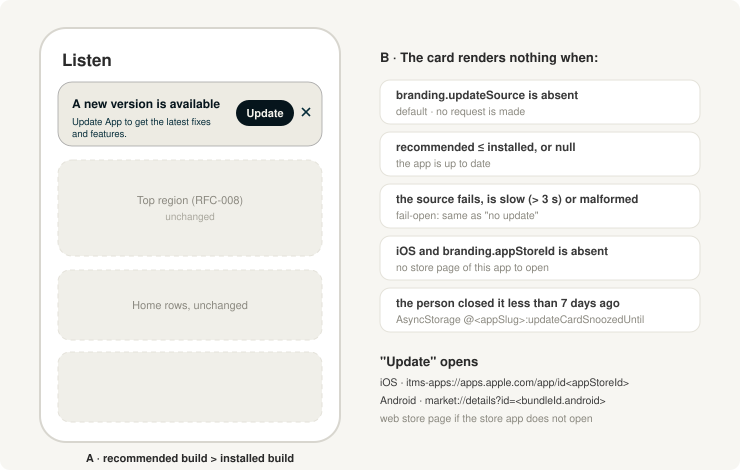

# RFC-025: "Update available" card — `branding.updateSource`

| Field   | Value                                                                                                      |
| ------- | ---------------------------------------------------------------------------------------------------------- |
| Status  | Proposed                                                                                                   |
| Date    | 2026-11-21                                                                                                 |
| Author  | Omar Zarka (@omar-zarka)                                                                                   |
| Related | RFC-007 (app-layer multi-tenancy), RFC-008 (Listen-tab top slot), RFC-010 (catalog version endpoint), RFC-017 (config envelope) |

## Summary

Add two optional branding fields, `updateSource?: UpdateSource` and `openUpdate?: (storeUrl: string) => Promise<boolean>`. When a tenant sets it, the app asks it for the newest build number that the tenant recommends on each platform. If that number is higher than the build number of the installed binary, a small card at the top of the Listen tab says that a new version is available. "Update" opens the store page of the app, or runs the tenant's `openUpdate` when it is set. The close button hides the card for 7 days.

Both fields are absent on Bayaan, so Bayaan's behavior does not change: no request, no card. The card never blocks the app. There is no "must update" screen and no push notification.

## Motivation

An app version stays on a phone until the store updates it. Many people turn off automatic updates, or their phone updates apps only on Wi-Fi and power. Today the app has no way to tell these people that a newer version exists. They stay on old builds with bugs that a later release fixed, and they report the same bugs again.

The app can already reach a store page: `utils/reviewUtils.ts` builds the review link from `branding.appStoreId` (`config/branding.d.ts:362`) and `branding.bundleId.android`. What is missing is (a) a signal that the installed build is old, and (b) a place to show it.

Each tenant knows its own release state, and each tenant may want a different signal:

- a small JSON document that the tenant serves on its own CDN (for example beside the RFC-010 catalog version file),
- an endpoint on its backend that follows the RFC-017 envelope.

So the signal is a seam, and the comparison, the link and the card are shared code.

A tenant must set the recommended build only when the store actually offers it to everybody. During a staged rollout, a person outside the rollout who taps "Update" sees no update in the store. A tenant-controlled number avoids this problem; a store lookup does not (see [Alternatives considered](#alternatives-considered)).

## Decision

### The seam

```typescript
// services/updateCheck.ts
export interface PlatformUpdateInfo {
  recommended: number | null; // null = no recommendation
}

export interface UpdateInfo {
  ios?: PlatformUpdateInfo;
  android?: PlatformUpdateInfo;
}

/** Resolves the recommended build numbers, or null for "nothing to say". */
export type UpdateSource = () => Promise<UpdateInfo | null>;
```

```typescript
// config/branding.d.ts
export interface Branding {
  // …existing fields…

  /**
   * RFC-025 — optional source for the "update available" card.
   * Field absent → no check, no request, no card. Bayaan ships this unset.
   * A rejected or slow source (over 3 s) counts as "no update".
   */
  updateSource?: UpdateSource;

  /**
   * RFC-025 — optional handler for the card's "Update" button, for a tenant
   * that starts the update itself (for example the Play in-app update
   * sheet). It gets the store link of this platform. Resolve true when it
   * handled the update. False, a rejection, or an absent field opens the
   * store link instead. Bayaan ships this unset.
   */
  openUpdate?: (storeUrl: string) => Promise<boolean>;
}
```

`recommended` is the store build number: `CFBundleVersion` on iOS and `versionCode` on Android. These are integers, so the comparison is a plain `>`. A semantic version string would need a parser and a rule for pre-release tags, and two builds can share one marketing version.

A tenant that serves a JSON file writes a source in a few lines:

```typescript
// a tenant's config/branding.js
updateSource: async () => {
  const res = await fetch('https://cdn.example.com/app-update.json');
  return res.ok ? res.json() : null;
},
```

```json
{
  "ios": {"recommended": 412},
  "android": {"recommended": 418}
}
```

The source owns transport, caching and auth. The module does not fetch anything itself. This keeps it independent of how a tenant hosts the data, and an RFC-017 envelope endpoint fits behind the same function (`return body.data`).

### The check

`checkForUpdate()` in `services/updateCheck.ts`:

1. No `branding.updateSource` → `{updateAvailable: false, storeUrl: null}`. The source is not called.
2. No store link for this platform → no update. On iOS the link needs `branding.appStoreId`; without it, the only page we could open belongs to another app (the same rule as the review link).
3. The installed build comes from `expo-application` `nativeBuildVersion`. This is the native value, so an over-the-air JS update does not change it. A value that is not a positive integer → no update.
4. The source runs with a 3-second limit. A reject, a synchronous throw, a timeout, or a value of the wrong shape → no update. A `recommended` that is not a positive integer → no update.
5. `recommended > installed` → `{updateAvailable: true, storeUrl}`. Otherwise no update.

The check never throws, and it never blocks start-up: the card hook calls it after the first render.

### Store links

| Platform | Link                                               | Fallback when the store app does not open it              |
| -------- | -------------------------------------------------- | --------------------------------------------------------- |
| iOS      | `itms-apps://apps.apple.com/app/id<appStoreId>`    | `https://apps.apple.com/app/id<appStoreId>`               |
| Android  | `market://details?id=<bundleId.android>`           | `https://play.google.com/store/apps/details?id=<package>` |

Both come from branding, never from a literal. `itms-apps://` opens the App Store app directly, with no Safari step.

`openStoreForUpdate()` first calls `branding.openUpdate(storeUrl)` when a tenant sets it. A tenant that wants the Play in-app update sheet puts that call (and its native library) in its own branding, and resolves `true`. When the handler resolves `false` or rejects (for example on a phone without Google Play), the store link above opens. The shared code needs no new native dependency.

### The card



`components/UpdateAvailableCard.tsx` renders above the RFC-008 top region in `components/RecitersView.tsx:865`, inside the scroll view. It renders `null` unless the check reports an update, so the Listen tab is byte-identical when the field is absent.

- An icon, a title ("Update available"), one line ("A new version of {appName} is ready."), a close button, and a filled "Update" button at the trailing edge. Strings in `home:updateCard.*` (English and Arabic in this PR).
- "Update" → `openStoreForUpdate()`. The card stays, so a person who comes back without an update still sees it.
- Close ("Hide for a week") → the card hides at once, and `@<appSlug>:updateCardSnoozedUntil` in AsyncStorage keeps it hidden for 7 days.
- Accessibility: the container is not one accessibility element, so screen readers reach both buttons; the close button is 44 × 44 pt; "Update" has the label "Update {appName} in the store". Padding uses start/end, so the layout mirrors in right-to-left languages.
- `hooks/useUpdateCheck.ts` runs the check once on mount, and again on `AppState 'active'` when the last check is more than 6 hours old. A release changes the answer at most a few times a week, so a tighter loop only adds requests.

### New dependency

`expo-application` (`~58.1.2`) is declared in `package.json`. It is already in the installed tree as a dependency of `expo-notifications`, so the native projects do not change. The declaration makes the import explicit instead of relying on a transitive package.

## Alternatives considered

- **Ask the stores for the newest version** (the iTunes lookup API on iOS, the Play in-app update API on Android). Rejected as the default. During a staged rollout the stores report a version that most people cannot get yet, so the card would send them to a store page with no update. The iTunes lookup also caches for hours and differs by country. A tenant that wants this can still write an `UpdateSource` that calls a store API.
- **A fixed endpoint URL in branding** (`updateEndpoint?: string`, like RFC-010). Rejected. It fixes the transport, the auth and the wire shape for every tenant, and a tenant that already has the number in another file would need a new endpoint. A function covers the URL case in three lines (above).
- **A blocking "update required" screen** (`required` next to `recommended`). Out of scope. A full-screen block is a large product decision, and a wrong number locks every user out. The shape leaves room to add it later as a new optional field without a break.
- **A push or local notification.** Out of scope. A notification needs a permission prompt and a reason to be in the notification tray; a tenant that already posts notifications can read `checkForUpdate()` itself.
- **Semantic version strings.** Rejected (see [The seam](#the-seam)).
- **The build number from `expo-constants`** (`expoConfig.ios.buildNumber` / `android.versionCode`). Rejected. When an over-the-air update is active, `expoConfig` comes from the update's manifest, so it can report the build of the config at publish time instead of the installed binary. `nativeBuildVersion` is the binary's own value.
- **The Play in-app update sheet in shared code.** Rejected. It needs a new native library that Bayaan does not need for a store link. `openUpdate` lets a tenant add it in its own branding.

## Consequences

- **Positive:** a tenant can tell people on old builds that a fix exists, with no app store review and no server push. The store link logic sits in one place.
- **Neutral:** Bayaan's behavior does not change; both fields are absent. The native projects do not change (`expo-application` is already linked). One new line renders the card in `RecitersView.tsx`.
- **Negative / risks:** a tenant that sets `recommended` too early sends people to a store page with no update. The doc comment on the field says when to set it. A slow source can delay the card, but never the screen: the limit is 3 seconds and the check runs after the first render.

## How we'll know it worked

- With `updateSource` absent, `components/__tests__/UpdateAvailableCard.test.tsx` shows no card and no call to the check, and the Listen tab renders as before on iOS and Android.
- `services/__tests__/updateCheck.test.ts` covers: an update on each platform with the branded link; no update for an equal, lower, null or malformed build; no update for a rejected, throwing or slow source; no iOS card without `appStoreId`; the web fallback; `openUpdate` handled, declined and rejected; the 7-day snooze.
- A tenant build with a source that recommends a higher build shows the card, "Update" opens the store page of that tenant's app, and the close hides it until 7 days pass.

## Open questions

- Should "Update" log an analytics event? This RFC adds none, so that each tenant chooses its own event name.
