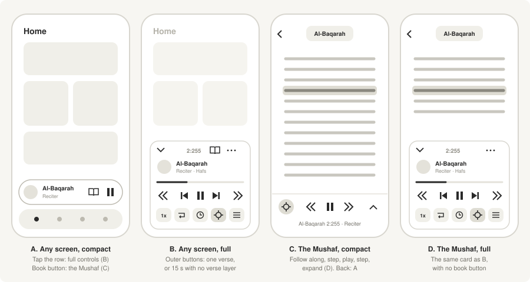

# RFC-026: One recitation player

| Field  | Value               |
| ------ | ------------------- |
| Status | Proposed            |
| Date   | 2026-11-21          |
| Author | Omar Zarka (Qariah) |

## Summary

Bayaan has two recitation players. The Listen player (`ExpoAudioService` and `usePlayerStore`) plays a queue of surahs. The Mushaf has its own player (`MushafAudioService` and `mushafPlayerStore`), which plays the same surah file and adds what the Mushaf needs: the verse that plays, verse steps, verse repeat and a range.

This RFC proposes one player. The Listen player plays every recitation. The Mushaf keeps all of its verse logic, but that logic follows the Listen session; it no longer owns a second `expo-audio` player. The controls become one set, in two sizes, the same on the Mushaf and off it.

It is delivered in five steps behind a flag. Each step is its own code PR with tests. Adhkar audio, ambient sounds, uploads, the verse numbering code and the recitation (microphone) mode do not change.

## Motivation

All line numbers are `develop` at `dee99c66a`.

### What each player can do today

| | Listen player | Mushaf player |
| --- | --- | --- |
| Plays a reciter that has no verse timings | Yes | No. `startPlayback` stops with an error (`store/mushafPlayerStore.ts:1351`), and its reciter list holds only reciters with timings (`:1451`) |
| Has controls outside its own screen | Yes, the mini player | No. The mini players read `usePlayerStore` only, and hide on the Mushaf (`components/player/v2/FloatingPlayer/index.tsx:44`, `:63`) |
| Queue, sleep timer | Yes (`services/player/store/playerStore.ts:1081`) | No. The sleep timer pauses the Listen player only |
| Widgets, Live Activity | Yes | No. `services/widgets/` reads `usePlayerStore` only |
| Returns to its position after a restart | Yes | No. Only preferences are saved (`store/mushafPlayerStore.ts:1484`) |
| Verse step, verse repeat, range | No. Repeat is off, queue or track (`components/player/v2/PlayerContent/ControlButtons/index.tsx:80`), and the step is 15 seconds | Yes |
| Speed, repeat, reciter | One value each | A second value each |

Both players play the same file for a surah. The difference is not the audio. It is what happens around it.

### What a listener meets

1. **A reciter with no timings does not play on the Mushaf.** The page is there and the audio exists, but Play gives an error. The Listen player plays the same reciter with no problem.
2. **Audio from the Mushaf has no controls after Back.** It continues, and no screen shows it. If a Listen track was paused before, the mini player shows that track, not the audio that plays.
3. **The Listen player knows the verse and cannot use it.** With timings it highlights the verse in its own list, but it has no verse step, no verse repeat and no range.
4. **Two settings for one thing.** A speed set in the Listen player does not apply on the Mushaf, and the same is true for repeat and for the reciter.
5. **The full player has no way to the page.** A tap on a notification or on the mini player opens the verse list of the full player. Its settings sheet hides the view type (`components/MushafSettingsContent.tsx:905` on `develop` `fdd80db7a`), and no control opens the Mushaf at the verse that plays. The only way today is Repeat in the verse sheet, which pauses the audio and opens the Playback Settings. On 2026-11-26 in Qariah, a listener opened a new recitation from its notification, and could not find how to change to the page view.

### The same work, two times

Each integration of a player has to be written, and then kept correct, one time for each player. Between 2026-11-14 and 2026-11-19 these commits on `develop` gave the Mushaf player behaviour that the Listen player already had:

- `7a30d3bf5`: it plays a downloaded surah, and reports a failed load.
- `35471a27b`: it leaves the lock screen on Stop, and the car's next and previous follow it.
- `99ea9c48b`: a surah cued while paused keeps the lock-screen controls.

Each of them is correct. Each exists because there are two players. The rows of the table above (mini player, queue, sleep timer, widgets, Live Activity, restart) are the same kind of work, still to do, with a second copy to keep correct afterwards.

## Decision

### 1. One player, and a verse layer that follows it

The Listen player is the only recitation player. A track that is a surah of a reciter can have a **verse layer**: the Mushaf's existing verse logic, attached to that track.

- **`MushafAudioService` stops creating a player** (`services/audio/MushafAudioService.ts:188`). It gets an attached mode. In that mode it holds the shared player of `services/audio/ExpoAudioProvider.tsx:101`, reads its position, seeks it, and reports verses as it does today. It never creates, releases or removes that player.

  ```ts
  /** Follow the Listen player, which plays `surah` with these timings. */
  attachToMain(surah: number, timestamps: AyahTimestamp[]): boolean;
  /** Stop following. The Listen player's playback does not change. */
  detachFromMain(): void;
  ```

- **`mushafPlayerStore` keeps its playback engine** (`createPlaybackEngine`, `store/mushafPlayerStore.ts:715`): the numbering, the verse units, `handleEntryChange` (`:909`), `loopToRangeStart` (`:880`) and `handleSurahEnd` (`:995`) decide what they decide today. Four actions connect it to the session:

  ```ts
  /** Load the timings of the session's surah, then track its verses. */
  attachSession(rewayatId: string, surah: number, reciterName: string): Promise<boolean>;
  detachSession(): void;
  /** A step by hand. It is not the reciter moving on: no verse repeat. */
  stepAyah(direction: 1 | -1): void;
  /** The track ended. True when a verse repeat or a range took it. */
  sessionTrackEnded(): boolean;
  ```

- **A small controller keeps them in step.** When the session's track changes, the verse layer detaches at once (no verse of the old surah shows on the new audio), and attaches again when the new surah has timings and Follow along is on. The Mushaf's reciter is the session's reciter. There is one speed.
- **`startPlayback(page, startAt)`** (`store/mushafPlayerStore.ts:1299`) loads a Listen queue: this surah, then the reciter's later surahs. It starts at the verse through the start position that `updateQueue` already takes. With no timings it starts at the beginning of the surah and says so; it does not refuse.
- **The end of a track asks the verse layer first.** `handleTrackEnd` (`services/audio/ExpoAudioProvider.tsx:515`) calls `sessionTrackEnded()`. A repeat of the last verse, or a range that ends there, takes the event. In every other case the queue goes on as today.
- **The verse tracker also runs on the player's status events.** Today it is a 200 ms timer (`services/audio/MushafAudioService.ts:400`). Android stops JavaScript timers while the app is not visible. In the prototype, a verse repeat of two did nothing in 75 s with the screen off on the timer alone, and repeated two times in 80 s with the `playbackStatusUpdate` events added (Android emulator, release build). While the app is not visible the events are used only when a verse repeat or a range is set, so plain listening updates no screen in the background.
- **A seek by hand is not the reciter moving on.** The scrubber, the 15-second step and a remote seek change the position under the verse layer. It shows the verse there and starts the repeat count again.

### 2. One set of controls



- **Two sizes.** Compact is the mini player off the Mushaf, and one row on the Mushaf. Full is the Listen player's card (track, scrubber, transport, tools). It opens over any screen from the mini player, and at the bottom of the Mushaf from its row.
- **The step buttons** move by one verse while the verse layer follows the session. In every other case they move by 15 seconds. Previous and next surah do not change.
- **Follow along is one button**, in the compact row on the Mushaf and in the full controls. It turns the verse layer on or off. When the reader is on a different page, a press goes back to the verse that plays. With no timings it is dim and explains why (the explainer sheet that exists).
- **Repeat is one control** with three independent parts: the recitation (off, surah, queue), each verse, and a range. The verse parts need the verse layer. The range picker of the Playback Settings sheet stays the way to choose a range that crosses surahs, and so does its redesign in #480.
- **The Mushaf has its own button** on the mini player and in the full controls. It opens the Mushaf at the verse that plays. Back takes it down. Neither changes the audio.
- **The page follows the audio until the reader turns it by hand.** Then it stays, and Follow along shows that it is not with the audio.
- **Every reciter is in the Mushaf's reciter list.** Those with timings are marked. A new reciter starts at the same verse.
- **"Play from here" has no range.** It starts at the verse, and the queue goes on into the next surah, as everywhere else. "Repeat" on a verse sets the loop, as today.

The verse list of the full player (`components/player/v2/PlayerContent/index.tsx:235`) is no longer the path for a surah: the Mushaf is. A track with no surah (an upload) keeps the full player as it is.

### What does not change

- The adhkar player, ambient sounds, and word audio.
- The recitation (microphone) mode: its bar (`components/mushaf/MushafPlayerBar.tsx:194`) and the rule that playback and the microphone stop each other.
- The verse numbering and verse unit code, the timings fetch and its cache.
- Uploads, downloads, the queue, the lock screen and the car for the Listen player. They now cover audio started on the Mushaf, with no code of their own for it.

### Delivery

A flag, `featureFlags.onePlayer`, off by default. While it is off, nothing changes.

1. **The verse layer can attach.** The attached mode, the four store actions and the controller, with tests. No caller yet.
2. **The Mushaf plays through the Listen player** with the flag on: `startPlayback`, `stop`, the end of a track, the status events.
3. **The controls:** the card in two places, the compact row, Follow along, Repeat, the queue as a sheet, the Mushaf button.
4. **iOS 26 and iPad:** the bottom accessory, the native Mushaf toolbar (`app/mushaf.tsx:313`), the iPad player.
5. **The flag is on by default, and the second player goes:** its `createAudioPlayer`, the Mushaf branch of the lock screen (`services/audio/LockScreenService.ts:446`), the playback states of `MushafPlayerBar`, and the sheet `mushaf-repeat-options`, which is registered (`components/sheets/sheets.tsx:82`) and never shown.

A prototype of steps 1 to 3 exists for Android phones. It was written on `develop` of 2026-11-17, before the fixes named above, so it needs a rebase before it can be a draft PR.

## Alternatives considered

1. **Keep two players, and give the Mushaf player the missing integrations one by one.** This is the direction of the recent fixes. Rejected: the mini player, the queue, the sleep timer, widgets, Live Activity and the restart each need a second implementation, and each stays a second thing to keep correct. A reciter with no timings would still need the Mushaf player to play without timings, which is the Listen player.
2. **Keep two players behind one set of controls.** A shared "now playing" model picks the player that is active, and the controls call that one. Rejected: the screen looks like one player, but the state is still two. The sleep timer, the queue and the widgets would each have to learn about the second player.
3. **Merge the two stores into one.** Rejected: the verse logic does not need to own playback to work. It needs a position, a seek and the end of a track. Keeping `mushafPlayerStore` as it is keeps its tests as they are.
4. **Make the Mushaf the only full player** (a tap on the mini player opens the Mushaf). Rejected after a device test: a listener who wants the speed or a 15-second step should not have to open the Mushaf.

## Consequences

- **Positive:** a reciter with no timings plays on the Mushaf. Audio started on the Mushaf has the mini player, the queue, the sleep timer, widgets, Live Activity and its position after a restart. The Listen player gets verse step, verse repeat and a range. One speed, one repeat control, one reciter. One `expo-audio` player for recitation.
- **Neutral:** the verse numbering, the verse units and the timings do not change. The Playback Settings sheet stays.
- **Negative / risks:**
  - It changes the most sensitive code of the app. The flag and the five steps are the answer; the second player is removed only in the last step.
  - Verse seeks now go through the Listen player, with its load and restore rules. The prototype found two cases there (a session restored after a launch reports position 0 until it plays). Step 2 needs tests for them.
  - A verse repeat with the screen off updates the verse in the background. On Android those updates wait until the app returns. The readers of the verse on the Mushaf need the same hold as the player screens (`hooks/useAppForeground.ts`).
  - Listening that starts on the Mushaf becomes a Listen session in analytics. The numbers of both change at the release.
  - The speed saved for the Mushaf is dropped in favour of the Listen speed.

## How we'll know it worked

- On the Mushaf, Play starts a reciter for which `timestampFetchService.hasSurah()` is false. The audio plays, no verse is highlighted, and no error shows.
- After Back from the Mushaf, the mini player shows the audio that plays, and controls it.
- From the full player of a surah, one tap opens the Mushaf at the verse that plays, and the audio continues.
- A sleep timer pauses audio that was started on the Mushaf.
- A track started from Listen, with timings, highlights its verse on the Mushaf, and takes a verse step and a verse repeat.
- A verse repeat of two repeats with the screen off (Android, 80 s, measured through the media session position).
- `createAudioPlayer` for a recitation appears one time, in `services/audio/ExpoAudioProvider.tsx`.
- The tests of `mushafPlayerStore` for numbering, units and labels pass with no change.

## Open questions

- **iOS 26:** whether the compact row on the Mushaf is the native toolbar or a row of its own.
- **iPad:** how the Now Playing column and the Mushaf share the window.
- **The Mushaf's reciter with no session:** the prototype uses the last reciter, then the default reciter. A separate "Mushaf reciter" preference may still be wanted.
