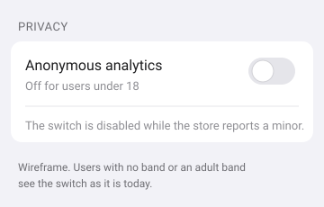

# RFC-027: Store age signals at launch, and safer defaults for a minor

| Field  | Value               |
| ------ | ------------------- |
| Status | Proposed            |
| Date   | 2026-11-23          |
| Author | Omar Zarka (Qariah) |

## Summary

From 2027-01-01, Google Play shares an age band with apps on a mandatory basis for every user in California (AB 1043) and in Brazil (Law 15.211/2025, the "Digital ECA"). California's law asks each app developer to request that signal when the app is downloaded and launched. Apple's Declared Age Range API gives the same kind of signal on iOS 26 and later. This RFC proposes one small seam: at launch, the app asks the store for the age band **only where a law makes the signal apply**, keeps the band on the device, and, for a minor, turns anonymous analytics off. Forks get one hook, `useIsMinor()`, to gate their own surfaces. Outside the regulated regions, nothing changes and no prompt shows.

We are not lawyers, and this is our reading of the laws. A store build with this change must reach users before 2027-01-01.

## Motivation

- Bayaan does not request an age signal today. `expo-age-range` is not in `package.json`, and no code calls Play Age Signals or Declared Age Range.
- Bayaan has anonymous PostHog analytics on by default (`store/analyticsConsentStore.ts:20`, applied in `services/analytics/AnalyticsService.ts:179`). Brazil's law asks for privacy-protective defaults for children (Art. 7 and Art. 17), and the age signal is the only way the app can know a user is a minor.
- Google sent the notice in November 2026. Play Age Signals 0.0.6 adds `getApplicableAgeFeatures()`, which says whether mandatory sharing applies to the current user (`ApplicableAgeFeature.MANDATORY_SHARING`). Without it, an app either prompts every Android user in the world, or it guesses the region.
- Google's terms allow the signal only for age-appropriate content and experiences, and never for "advertising, marketing, user profiling, or analytics". So the band must stay on the device and never reach PostHog or Sentry.
- Every fork that ships on Play in California has the same duty. One shared seam costs less than one copy in each fork, and it keeps `app/_layout.tsx` and `AnalyticsService.ts` free of fork edits.

## Decision

### 1. The module

Add `expo-age-range` (SDK 58, `npx expo install expo-age-range`). It wraps Play Age Signals on Android and Declared Age Range on iOS, and its config plugin adds the iOS entitlement `com.apple.developer.declared-age-range`.

`expo-age-range` 58.0.3 uses Play Age Signals 0.0.4, which does not have `getApplicableAgeFeatures()`. Add it with a small `patches/expo-age-range+58.0.3.patch` (the repo already uses `patch-package`): move the Android dependency to `com.google.android.play:age-signals:0.0.6`, and export `getApplicableAgeFeaturesAsync(): Promise<string[] | null>`. Send the same change to Expo, and remove the patch when a release has it.

### 2. When the app asks

A new `services/ageSignals/AgeSignalService.ts` exports `checkAgeSignals()`. The phone layout calls it once per process, after `bootApp()` resolves and the splash hides. It never runs in the headless Android Auto root, and it never blocks the splash.

```ts
// Android
const features = await getApplicableAgeFeaturesAsync();
if (!features?.includes('MANDATORY_SHARING')) return; // no law applies: no prompt
const status = await requestAgeSignalsAccessAsync(); // SHARED / NOT_SHARED / VERIFICATION_REQUIRED
if (status === 'SHARED')
  band = await requestAgeRangeAsync({threshold1: 13, threshold2: 16, threshold3: 18});

// iOS 26.2 and later
if ((await isEligibleForAgeFeaturesAsync()) !== true) return; // false or unknown: no prompt
band = await requestAgeRangeAsync({threshold1: 13, threshold2: 16, threshold3: 18});
```

A retryable error is retried at most twice. Any other error leaves the last saved band as it is, and the app works as before.

### 3. What the app keeps

```ts
// services/ageSignals/ageSignalStore.ts (persisted with persistStorage(), on the device only)
interface AgeSignalState {
  lowerBound: number | null;
  upperBound: number | null;
  status: string | null; // the store's status, for example 'SHARED'
  checkedAt: number | null;
}
```

The band, the status and the check time never go to PostHog, Sentry or any server. A test asserts that no analytics event and no Sentry scope carries them.

### 4. The config, and the one rule in Bayaan

```ts
// config/ageSignals.ts, replaced by a fork the same way as config/featureFlags.ts
export const ageSignals = {
  enabled: true, // false: checkAgeSignals() does nothing
  minorBelow: 18, // a band whose upper bound is below this is a minor
} as const;
```

`useIsMinor()` is true only when the store reported a band and its upper bound is below `minorBelow`. No band means "not known", and the app keeps its current behaviour.

For a minor, Bayaan turns anonymous analytics off. `AnalyticsService.applyConsent` uses `analyticsEnabled && !isMinor()`. The user's own choice in `analyticsConsentStore` does not change, so it comes back if the band changes. In Settings → Privacy, the analytics switch shows off and disabled, with one line under it:



### 5. The hook for forks

`useIsMinor()` and `isMinor()` are exported from `services/ageSignals/`. A fork that has its own surfaces for a minor (for example, publishing user-written content to a public service) gates them with this hook, with no edit to a shared file.

### 6. Tests

- Android: no access request when the feature set is empty; the access request and the range check when it holds `MANDATORY_SHARING`; no range check when the status is not `SHARED`.
- iOS: no prompt when eligibility is `false` or `null`.
- A band of 13–15 with `minorBelow: 18` turns analytics off; a band of 18+ and no band leave it as the user set it.
- No age value reaches `analyticsService` or `Sentry`.
- `enabled: false` makes no native call.

## Alternatives considered

- **Prompt every user worldwide.** Play 0.0.6 can show its age prompt in any country. Rejected: users outside the regulated regions would see a system prompt that no law asks for.
- **Our own age screen (a birth year).** Rejected: it collects more data than the store band, it is easy to lie to, and it does not meet a law that asks for the store's signal.
- **Guess the region from the IP address or the locale.** Rejected: `getApplicableAgeFeatures()` and `isEligibleForAgeFeatures` give the store's own answer, and a guess can be wrong in both directions.
- **Write the native module ourselves.** Rejected: `expo-age-range` already covers both platforms and the iOS entitlement. A patch for one method is smaller than a new native module.
- **Each fork adds this on its own.** Rejected: the duty is the same for every app on Play in California, and the edits would land in `app/_layout.tsx` and `AnalyticsService.ts`, which change often upstream.

## Consequences

- **Positive:** the app requests the signal where the laws apply, before 2027-01-01. A minor gets analytics off by default. Forks get one hook and one config file.
- **Neutral:** outside the regulated regions, and on iOS before 26.2, nothing changes. Listening, reading and downloads do not change for anyone.
- **Negative / risks:**
  - A native module, so the change ships in a store build, not an over-the-air update.
  - Users in California and Brazil can see a Play or Apple prompt once.
  - Play returns a real answer only to an app installed from Play. A debug build must use `setFakeAgeSignals()`.
  - Until Expo ships `getApplicableAgeFeatures()`, the patch must be checked at each `expo-age-range` upgrade.

## How we'll know it worked

- The tests in Decision 6 pass in CI.
- On an Android debug build with `setFakeAgeSignals({ageSignalsStatus: 'SHARED', lowerBound: 13, upperBound: 15})`, Settings → Privacy shows analytics off and disabled, and PostHog receives no event from that device.
- On a build from a Play testing track, outside California and Brazil, no prompt shows.
- No PostHog event property and no Sentry tag holds an age value.

## Open questions

- Significant-change notices and parental approval (Texas, Utah) are out of scope. They apply mostly to apps with purchases.
- A fork that wants a lower `minorBelow` (for example 13) sets it in its own `config/ageSignals.ts`.
- We can write the code PR as soon as the shape is agreed.
