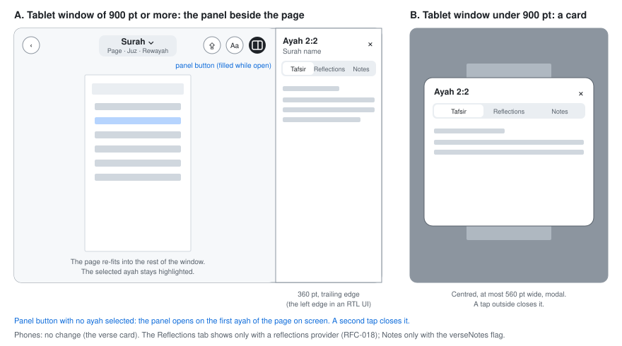

# RFC-029: The ayah side panel in the tablet Mushaf reader

| Field      | Value                                                                                                                                  |
| ---------- | -------------------------------------------------------------------------------------------------------------------------------------- |
| Status     | Proposed (design only; a code PR follows acceptance)                                                                                   |
| Date       | 2026-11-24                                                                                                                             |
| Author     | Omar Zarka (Qariah)                                                                                                                    |
| Builds on  | `docs/design/ipad-standards.md` §8; `docs/design/reading/03-proposed-designs.md` §1 and §3; `docs/design/reading/05-roadmap.md` 2.1–2.2; RFC-018 |

## Summary

On a tablet, the Tafsir, Reflections and Notes of one ayah open in a panel beside the Mushaf page, so the reader sees the page and the study text together. In a window of 900 pt or more, the panel is a 360 pt column at the trailing edge, and the page re-fits into the rest of the window. In a narrower tablet window, the same panel shows as a centred card. A long-press on another ayah moves the panel to that ayah. A new panel button in the reader header opens and closes the panel. With no ayah selected, the button opens the panel on the first ayah of the page on screen. Phones do not change.

This is a first, small build of the Study pane in `docs/design/reading/03-proposed-designs.md` §1 (roadmap steps 2.1 and 2.2), with three tabs. The other Study tabs can come later in the same host.



## Motivation

- `docs/design/ipad-standards.md` §8 says that reading-adjacent panels (tafsir, notes, verse actions) **SHOULD** show as a trailing side panel at `expanded`+, so the page stays visible. Its status table (row 6) says: "Trailing side panels for tafsir and verse actions are not built".
- Today, on a tablet, Tafsir, Reflections and Notes are screens of the verse card (`components/sheets/VerseActionsSheet.tsx:490` `handleNote`, `:562` `handleTafseer`, `:596` `handleCommunityReflections`). The card is centred and up to 560 × 760 pt, so it covers the page. To read the tafsir of the next ayah, the reader closes the card, long-presses the ayah and opens Tafsir again.
- #453 makes the card's screens fit the card. It keeps the card model, so the page is still covered.

## Decision

### 1. Presentation by window

| Window | Presentation |
| --- | --- |
| Phone (any width) | No change: the verse card, as today. |
| Tablet, width < 900 pt (`compact` and `medium`) | A centred card: `components/layout/TabletDialog.tsx`, at most 560 pt wide and 560 pt tall. It is modal: VoiceOver and TalkBack skip the reader under it, and a tap outside closes it. The header and toolbar hide while it shows. |
| Tablet, width ≥ 900 pt (`expanded` and `large`) | A docked column, 360 pt wide, at the trailing edge (the left edge in an RTL UI). The reader pane gets the rest of the width and re-fits the page. A spread shows only when each page is at least 420 pt wide, else one page (`03-proposed-designs.md` §1.1). The header buttons stay over the reader pane. |

A window that crosses 900 pt (rotation, Split View, Stage Manager) swaps the column and the card. The ayah, the tab and an unsaved note stay.

### 2. Content

- **Header:** "Ayah S:A" in the numbering of the rewayah on screen, the surah name, and a close button (×).
- **Tabs** (a segmented control): **Tafsir**, **Reflections**, **Notes**.
  - Reflections shows only when `branding.communityReflectionsProvider` is set (RFC-018).
  - Notes shows only when `featureFlags.verseNotes` is on.
- Each tab body is the content component that the verse card uses now: `TafseerContent`, `CommunityReflectionsContent`, `NoteContent` (`components/sheets/verse-actions/`). The panel adds no second copy of this UI.

### 3. How the panel opens and moves

- **From the verse card.** On a tablet, in the Mushaf reader, with one ayah selected: Tafsir, Reflections and Note close the card and open the panel on that tab. A range, or the verse card from the player's verse view, keeps the card's own screens as today.
- **A long-press while the panel is open** moves the panel to the pressed ayah, on the same tab, and opens no card. A long-press on a range opens the verse card as today.
- **An unsaved note keeps its ayah.** While the Notes tab has text that is not saved, a long-press on another ayah does not move the panel. The panel keeps its ayah and the text.
- **The highlight stays.** The panel's ayah stays selected on the page while the panel is open. The verse card clears the selection when it closes, so the panel puts it back.

### 4. The panel button

On a tablet, the reader header gets one more button, at the trailing end of its buttons: on the iOS 26 glass header in `headerRight` (`components/mushaf/main.tsx:1058`), and on the other header in its right side (`components/mushaf/main.tsx:1727`). The icon is a trailing sidebar, filled while the panel is open.

| State when tapped | Result |
| --- | --- |
| Panel open | The panel closes. |
| Panel closed, one ayah selected | The panel opens on that ayah. |
| Panel closed, a range selected | The panel opens on the first ayah of the range. |
| Panel closed, **no ayah selected** | The panel opens on the **first ayah of the page on screen**: `mushafVerseMapService.getOrderedUnitKeysForPage(currentPage)[0]` (`services/mushaf/MushafVerseMapService.ts:523`). In a spread, `currentPage` is the page that `spreadPageToShow` reports (`components/mushaf/spreadPage.ts`). If the page starts inside an ayah, that is the ayah. |

The panel opens on the tab used last in this session, else on Tafsir. The button has `accessibilityRole="button"`, the label "Ayah panel", and `accessibilityState={{expanded}}`. It hides in immersive mode and in search, as the other header buttons do.

The button does not show on phones, so a phone in landscape (wider than 900 pt) does not get the panel.

### 5. How the panel closes

The × button, the panel button, Android back, a tap outside the card, a change of rewayah (the ayah key is in the old numbering), and leaving the reader.

### 6. State

A small zustand store, `components/mushaf/ayah-panel/ayahPanelStore.ts`:

```ts
type AyahPanelTab = 'tafsir' | 'reflections' | 'notes';

interface AyahPanelState {
  payload: VerseActionsPayload | null; // the ayah; null while closed
  tab: AyahPanelTab;
  compose: boolean; // the Notes tab shows the editor
  drafts: Record<string, {text: string}>; // unsaved notes, by "rewayah S:A"
  hosts: number; // mounted readers that can show the panel
}
```

The payload is the existing `verse-actions` sheet payload, so the verse card and the panel name an ayah in the same way. A draft outlives the column-to-card swap and a close. A save or a cancel clears it. The panel closes when the last reader that can host it unmounts.

## Alternatives considered

- **The full Study pane first** (six tabs, a width of 340–480 pt that the user drags, and the Contents pane, `03-proposed-designs.md` §1). It is the target, but it is several PRs of work. The three tabs here are the ones that a reader most often keeps open beside the page. The host, the store and the button do not change when more tabs come.
- **An overlay panel at `medium`** (`03-proposed-designs.md` §1.1). It needs a new slide-over primitive. The centred card exists (`TabletDialog`), and `ipad-standards.md` §8 allows a card at `medium`. Rejected for now (see "Open questions").
- **Keep the verse card** (#453). It still covers the page, which is the problem this RFC solves.
- **Disable the panel button when no ayah is selected.** A disabled button does not say what to do next. An empty panel with "Select an ayah" costs one more step. Rejected for "the first ayah of the page", which shows useful text at once and follows the page the reader is on.
- **Open the panel at the ayah that is playing.** The reader opens the panel to study the page, not the recitation, and with no audio there is no such ayah. Rejected. The selection rule above already covers an ayah that the reader long-pressed.

## Consequences

- **Positive:** at 900 pt and more, the page and the tafsir, reflections or notes are on the screen together. The panel follows a long-press, so a reader steps through the ayahs of a page with one gesture each. An unsaved note is not lost when the window changes size.
- **Neutral:** phones do not change. The verse card does not change for a range, for the player's verse view, or for its other screens (Translation, Word study, Similar verses, Share, Highlight).
- **Negative / risks:**
  - The same content has two hosts (the card screen and the panel). Both use the same content components, so a fix in one reaches the other.
  - With the panel open on an 11-inch iPad in landscape (1194 pt), each page of a spread would be about 417 pt, under the 420 pt floor, so the reader shows one page. This is the rule in `03-proposed-designs.md` §1.1, but it is a visible change when the panel opens.

## How we'll know it worked

- Jest, the store: open, move on a long-press, keep the ayah while a note has unsaved text, keep a draft across a column-to-card swap and a close, close on a rewayah change and when the last host unmounts.
- Jest, the presentation: no panel on a phone at any width; a card under 900 pt; a column at 900 pt and more.
- Jest, the panel button: no selection opens the first key of `getOrderedUnitKeysForPage(currentPage)`; one ayah opens that ayah; a range opens its first ayah; a tap while open closes; the button is filled only while open; no button on a phone.
- Device: iPad 11-inch and 13-inch, in landscape (the column) and in portrait (the card on the 11-inch); an iPhone in landscape (no change); VoiceOver reads the button state and the card is modal; Android tablet: back closes the panel first.

## Open questions

- **More Study tabs:** Translation, Word study and Similar verses (`05-roadmap.md` 2.2). The host and the store take them with no change.
- **An overlay at `medium`**, in place of the card, when a slide-over primitive exists.
- **A width that the user can drag** (340–480 pt) and the keyboard shortcut ⌘⌥2 (`05-roadmap.md` 3.1).
