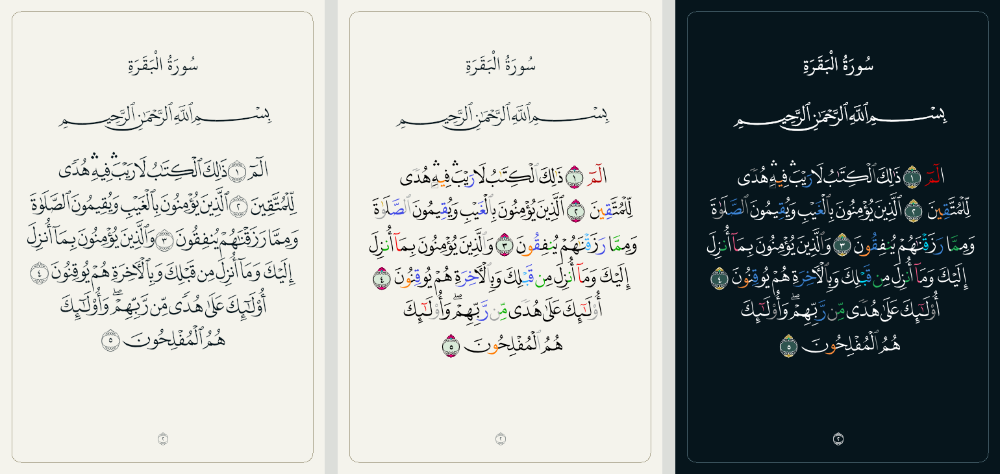

# Mushaf 1440 tajweed preview

Select **Mushaf 1440** in the reader settings, then use **Tajweed Coloring** to compare the colored and monochrome fonts. Selecting 1440 enables the preview; the toggle can turn it off. Existing 1440 settings migrate to the enabled preview once. This renderer remains Hafs-only.

This comparison renders the real page fonts and bundled word codes through CanvasKit. It is a font preview, not a screenshot of the native settings or reader chrome.

## Font and layout behavior

- Tajweed on loads QUL's per-page V4 TTF files from `https://static-cdn.tarteel.ai/qul/fonts/quran_fonts/v4-tajweed/ttf/p{page}.ttf`. Tajweed off uses the existing V2 fonts.
- V4 supplies its own word shapes and tajweed colors. All 83,668 bundled QCF word codes were checked against `data/mushaf/legacy/qpc-v4.json` and match by location.
- Light and dark reading themes share one downloaded V4 file. The dark variant selects the font's published night palette in memory, preserving glyph data and the cached file.
- Fonts register separately for each Skia provider and variant. Failed downloads are removed, unreadable cached fonts are evicted, and the reader offers retry or a return to monochrome.
- Page dimensions follow the reader's current layout, including iPad spreads. Cached font sizes include content width, and the canvas keeps space below the last line for its marks.
- Colored paragraphs are measured before positioning. When their taller line boxes exceed the content area, vertical spacing contracts enough to keep the final line above the playback controls without shrinking the glyphs.

## Validation

Automated checks cover palette integrity, concurrent font loading, provider isolation, download recovery, layout-cache isolation, settings migration, and Hafs gating. The related mushaf, store, and rewayah-selection suites passed: 686 tests, with 25 existing skips. TypeScript and changed-file ESLint completed without errors.

Native iPad simulator checks verified light and dark colors, switching back to V2, and pages 1–4 in a facing-page spread.

An Android 15 ARM64 phone emulator (1080 × 2400) verified startup, pages 2–3, light/dark tajweed palettes, switching to V2 and back, and the saved tajweed setting after restarting the debug app. The Android pass exposed a taller V4 last line beneath the playback controls; measured vertical fitting corrected it, and the full final line was verified with controls visible. Three focused regression tests cover this fit. These checks cover the reader flow, not the entire app or a standalone release build.

For a manual pass:

1. Open page 2 in 1440, toggle tajweed off and on, and switch between light and dark reading themes.
2. Navigate to page 3 and confirm the final line and its marks are visible. Check a surah-start page and page 604 as well.
3. Rotate or resize the reader and verify page widths, headers, and verse-selection alignment.
4. Visit an uncached page offline. Restore the connection and retry, then check that a cached page works offline.
5. Start with a non-Hafs riwayah and select 1440. Confirm the existing Hafs-switch flow completes before the font changes.
