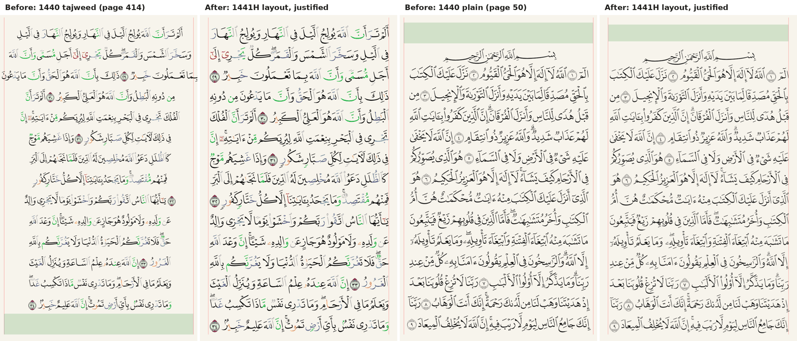

# Mushaf 1440: manual test plan

Mushaf 1440 draws the 1441H Madinah print (see
[features/mushaf-1440.md](../features/mushaf-1440.md)). Automated tests cover
the data, the layout of all 604 pages with the real fonts, the word map to the
shared overlays, the drawing data and the rewayah flows. A device pass checks
what they cannot: the fonts on screen.

The image renders the real page fonts and the bundled layout through CanvasKit
(the left of each pair is the beta renderer). It is not a screenshot of the app.

## Pages and alignment

1. Select **Mushaf 1440** in Mushaf Settings › Font. Open page 50: every full
   line is flush with both margins.
2. Open page 414: 15 lines of Luqman and no title at the bottom. Page 415
   opens with the As-Sajdah title and basmala.
3. Check pages 1 and 2 (centred, framed), 528 (a centred short line before
   Al-Qamar), 585 (a dense page) and 604.
4. Toggle **Tajweed Coloring**: the line breaks stay; switch between light and
   dark reading themes (night palette under tajweed; the theme's text colour
   without it).
5. Rotate, and check iPad spreads (pages 1–2, 414–415) and the vertical
   scroll in Mushaf Settings › Scroll.

## Overlays

1. Long-press a verse: the selection band covers exactly its words, also when
   the verse wraps. Drag on iOS to extend.
2. Bookmark and colour-highlight a verse; enable Themes.
3. Play a Hafs reciter with timings, then a Warsh reciter: the band follows,
   and turns the page.
4. Recite with the mic: the recited ayah tint and the word being recited;
   misread a word (red with a dotted underline, tap opens the mistake sheet);
   turn on **Hide text** and check words appear as you recite while ayah
   markers stay.
5. Repeat 4 with tajweed on: mistakes still show in red.
6. Text weight Medium and Bold; Allah's name highlight with and without
   tajweed.

## Rewayat

1. Under Mushaf 1440, pick Warsh in the Rewayah picker: the pages show Warsh in
   the Madani 1421 font with Show differences; Mushaf 1440 stays selected.
2. Pick Hafs again: the 1441H glyphs return.
3. Open a bookmark saved in Qalun: it opens in Qalun.
4. With Warsh selected, check the List view and the player's verse list.

## Offline and errors

1. Visit an uncached page offline: the page offers Try again. Restore the
   connection and retry.
2. A cached page works offline in all three variants (plain, tajweed day,
   tajweed night).
